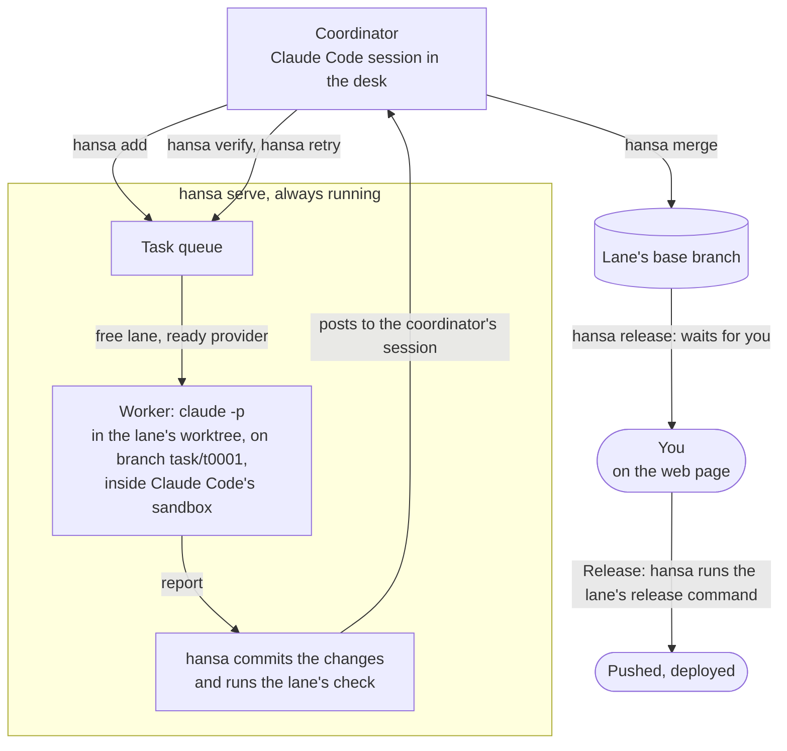

# Hansa Agents

[简体中文](README.zh-CN.md)

**You say what you want and approve what ships; a team of coding agents plans, builds, tests and checks each other's work, on a machine you control.**

You talk to one agent, the coordinator. It splits the work into tasks, and each goes to a worker, another agent, in
its own sandbox (a fenced-off space) and on its own branch (a separate line of your code). Hansa commits the result and
runs your tests; another worker tries the change to see whether it holds; then it merges. A release goes out only with
your yes, given each time or in advance.

| | |
|---|---|
| **Status** | Alpha, `0.5.0a1`: settings, commands and files may still change. Up to 0.4 the project was called Bellhop. |
| **Runs on** | macOS or Linux, with Python 3.9 or newer, git and Claude Code; [`hansa doctor`](#quick-start) checks the machine |
| **Interfaces** | The `hansa` menu and command; a web page reached through an SSH tunnel (a private link from your computer) |
| **License** | Apache-2.0 |

## Who it is for

**For:**

- Someone who runs a product, does not write code and wants a team of agents.
- A developer with more work than one agent session can hold.

**Not for:**

- Designing a feature interactively: design elsewhere, then hand the result to hansa as a task's input.
- A laptop you close at night. Hansa belongs on a machine that stays on, a Mac mini, a home server, a Linux box, which
  you reach over SSH and tmux (a remote login, and a session that outlives it) from wherever you are.

## Quick start

```sh
curl -fsSL https://raw.githubusercontent.com/FrostNovaOrg/Hansa/main/install.sh | sh
hansa doctor
hansa init ~/shop/desk --repo ~/shop/repo
hansa
```

If your shell cannot find `hansa`, add the `export PATH` line the installer printed.

`~/shop/repo` is your project's git repository, with at least one commit; `~/shop/desk` is the new desk, the folder that holds your team's settings and tasks. [Getting started](docs/getting-started.md) covers the rest.

## How it works

A lane is one working copy of your code (its worktree) with its own rules: its model providers, reachable hosts, tests
(its check) and releases.



1. **The coordinator queues a task**: one change a worker can make and check on its own.
2. **`hansa serve`, the program that stays running, starts it** on a free lane: a worker makes the change in its sandbox
   and reports.
3. **hansa commits and checks.** It runs the lane's tests itself, so the result does not depend on what the worker says.
4. **The coordinator reviews.** For code, another worker tries the change to see whether it holds; then it merges or
   sends it back.
5. **You release.** hansa merges into the lane's base branch, where its work lands, and stops. After your yes, or for a
   target you approved in advance, it runs the lane's release command, such as a deploy.

## Several models, on purpose

A lane can use a Claude Code login, any endpoint that speaks the Anthropic API (for example DeepSeek's or Kimi's), or,
on macOS, Codex's command line through [`contrib/codex`](contrib/codex/README.md). A change can be verified on a
different model from the one that wrote it, and a model provider at its usage limit hands its task to the next.

## What it has done

Hansa is developed with Hansa. One desk, the 60 days to 2 November 2026; your numbers will differ.

| | |
|---|---|
| Changes merged | 345 |
| Merged without being sent back | 57% |
| Verifications that said "does not hold" | 37% |
| Cost per merged change, at list prices | US$8.65, everything included (coordinator, workers and verification) |

On a subscription the bill is the subscription; the figure is what the tokens are worth at list prices.

## Your Claude Code, your login

Hansa runs the Claude Code you installed yourself, signed in with your own account or key. It does not include, change
or resell Claude Code. What the workers use counts against your own plan, under your provider's terms; heavy use
reaches a plan's limits sooner. Do not offer a desk to other people on a subscription login: Anthropic's usage policy
does not allow services that route requests through consumer plans. Hansa is an independent project, not affiliated
with or endorsed by Anthropic or OpenAI.

## What keeps it safe

- **Workers run in the operating system's sandbox.** Their commands write only where their lane allows, reach only the
  hosts it lists, and cannot read the desk's keys; web tools you allow on a lane run outside that list.
  [Workers and the sandbox](docs/sandbox.md)
- **The coordinator works in the open.** It is not sandboxed: Claude Code asks you before each command not already
  allowed, and rules deny it the keys and direct code edits. Rules against pushing catch only the forms they name; the
  rest rely on that asking. [Who changes what](docs/who-changes-what.md)
- **Releases wait for you.** A release runs only after your yes, or for a target you approved in advance. It runs
  outside the sandbox, with the desk account's logins. [Releases and alerts](docs/releases.md)
- **Keys stay out of sight.** They live in `secrets/`, readable by hansa's account, and go only to the provider. hansa
  hides a key wherever it would show and refuses to merge one, but cannot see into compressed files.
  [The desk](docs/desk.md#where-a-desks-files-are)
- **The page is private by default.** It listens only on the machine itself, and its data and actions need the
  token in the address `hansa web` prints. `hansa serve --host` can open it wider, and whoever holds that address can approve a release.
  [The token](docs/who-changes-what.md#a-claude-code-sessions-identity-and-the-pages-token)

More: [Limits](docs/concepts.md#limits).

## Documentation

Nobody reads hansa's code to use it.

| Document | What is in it |
|---|---|
| [`hansa/card.md`](hansa/card.md) | What the coordinator needs on every turn: how work moves, every command, what it may change; `hansa help <topic>` prints the rest from `docs/`. `hansa help card` prints it, and each desk holds a copy as `CLAUDE.md`. |
| [Concepts](docs/concepts.md) | Key terms, the desk's files, macOS and Linux, limits, commands, upgrading |
| [Getting started](docs/getting-started.md) | Install, log in, create a desk, reach its page over SSH, and finish the first task |
| [How a desk is run](docs/principles.md) | The rules hansa is built around, what enforces them and what each guards against |
| [Who changes what](docs/who-changes-what.md) | What you set on the page and the coordinator with `hansa`: lanes, commit messages and identity, what stays closed to the coordinator |
| [Workers and the sandbox](docs/sandbox.md) | What workers and verifiers may touch; git's folders; the sandbox probe; write lists and env; the allow list and its web tools; paths hansa refuses; what hansa stops when a run ends |
| [How a task runs](docs/tasks.md) | Time limits and resumes, retries after a dropped connection, providers' usage limits |
| [Releases and alerts](docs/releases.md) | Release targets, answers by one-time code, files a release runs, stopping a release, your alert command |
| [On a Linux server](docs/linux-server.md) | The coordinator as root, the desk as an ordinary account; what a lane's commands meet in Linux's sandbox |
| [Java and Maven in a lane](docs/java-and-maven.md) | What hansa sets up for Maven and Java in the sandbox, what that changes for a build script (`mktemp` on macOS too), and what a project and its lane need |
| [The desk: files, keys and notes](docs/desk.md) | Keys, the coordinator's permission rules and notes, the project's own rules, what the coordinator's session leaves out, the floor of free space, where a desk's files grow |
| [CHANGELOG.md](CHANGELOG.md) | What changed in each version, Bellhop's included |
| [CONTRIBUTING.md](CONTRIBUTING.md) | How to change hansa, and the licensing of contributions |

## Contributing and license

To change hansa, read [CONTRIBUTING.md](CONTRIBUTING.md).

[Apache-2.0](LICENSE). Copyright (c) 2026 FrostNovaOrg.
