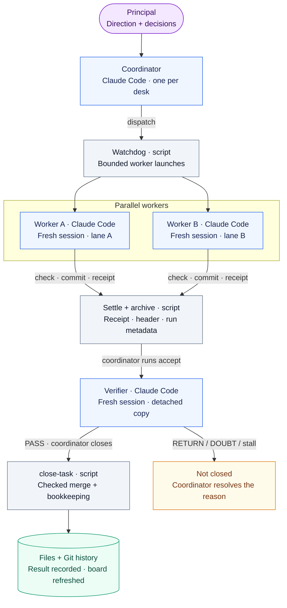
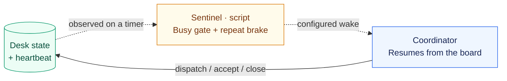

# Bellhop

**Auditable operations for a team of Claude Code agents.**

A human principal sets direction. One coordinator dispatches small tasks to fresh
worker sessions, a separate verifier checks the results, and scripts handle the
queue, records, merge gates and supervision. Decisions, task packets, receipts
and the next action survive in files and Git history when a session ends.

[Try the demo](#try-the-demo) · [Set up a desk](#set-up-a-desk) ·
[How it works](#how-the-desk-works) · [Design principles](#design-principles) ·
[Documentation](#documentation)

## How the desk works

Claude Code sessions make judgments and do the work. Bellhop scripts dispatch,
measure, record and supervise.

**Task flow — from a recorded decision to acceptance and closing.**



**Supervision loop — runs alongside tasks, not after them.**



**Files are the source of truth throughout the loop.** Each handoff leaves a record;
the coordinator reads the board again when it resumes. Helpers (Claude Code
subagents) support the coordinator's research, walkthroughs and drafts; they do not
own worker tasks or replace their receipts.

- **Parallel work, serialized records.** The default is one worker at a time,
  raised with `max_parallel_workers` once a lane has gone end to end. Lane claims
  prevent overlap on one lane; shared state and Git updates use the desk lock. Heartbeats continue while
  workers run. See [concurrency and recovery](docs/concurrency.md).
- **Independent acceptance before every merge.** The verifier has its own model
  settings and may make reversible mutations in its disposable copy. Sampling
  selects extra review; `return`, `doubt` or a stalled run stops closing. See
  [acceptance](docs/acceptance.md) and [close-task](docs/close-task.md).
- **Supervision is a separate loop.** The sentinel observes throughout execution;
  a configured wake command resumes the coordinator when its gates allow it.
  See [sentinel](docs/sentinel.md). The diagram assumes the
  [Claude Code workflow contract](docs/replicate-claude-workflow.md).

## Try the demo

Requirements: **Git and Python 3.9+ on macOS or Linux**. The framework uses only the
Python standard library. Configure a Git author name and email before creating a
desk, since initialization and the workflow make commits.

```sh
git clone https://github.com/FrostNovaOrg/Hansa.git bellhop
cd bellhop
./examples/demo.sh
```

The demo creates a temporary fictional product and desk, then runs dispatch,
worker execution, acceptance, checked merge and daily close. It uses stub sessions,
calls no model API, and prints the workspace path so you can inspect the receipts
and commit history afterwards.

## Set up a desk

Real agent runs require **Claude Code installed and authenticated** on the host.
Keep the coordination desk separate from the product repository it manages.

### Install the Claude Code plugin

Run these commands inside Claude Code:

```text
/plugin marketplace add FrostNovaOrg/Hansa
/plugin install bellhop@bellhop
```

Open Claude Code in an **empty desk directory**, then run:

```text
/bellhop:init .
```

The plugin supplies task skills, coordinator helpers, hooks and an MCP server.
The MCP server hosts a session watchdog; resident services are configured
separately. See [plugin installation and supervision](docs/plugin.md).

### Configure the first lane

Edit the generated `bellhop.json` and `rules/lanes/<lane>.md` for the product.
Start with one small task on one lane.

| Setting | What to establish |
|---|---|
| `lanes.<lane>.repo` / `branch` | The product repository and integration branch |
| `lanes.<lane>.check_cmd` / `allowed_tools` | A meaningful full check and the tool permissions needed to run it and commit |
| `lanes.<lane>.model` | The worker model available through your Claude Code installation |
| `accept_model` / `accept_effort` | Independent verifier settings; non-empty lane overrides take precedence |
| `max_parallel_workers` | Ships as `1`; raise it only after one real task has closed cleanly |
| `wake_cmd` / `busy_probe_cmd` | The host's actual wake and busy-state adapters, before relying on automatic resumption |

Record standing decisions, seal the desk, then use `/bellhop:dispatch` for a task
with explicit scope and observable acceptance criteria. On return,
`/bellhop:intake` runs acceptance and `close-task`. Close that task before reusing
its lane. The [replication guide](docs/replicate-claude-workflow.md) covers this
first run and the failure cases to exercise.

<details>
<summary>Use the CLI from a checkout</summary>

From the `bellhop` checkout created above:

```sh
./bin/bellhop init ../my-desk
cd ../my-desk
```

Configure `bellhop.json` and the lane rules first. Create `body.md` with
`## What to do`, `## Do not touch` and `## Acceptance` sections; each acceptance
bullet must name an observable result for your product. Then:

```sh
../bellhop/bin/bellhop provider check api
../bellhop/bin/bellhop seal
../bellhop/bin/bellhop dispatch --lane api --title "A small first task" --body body.md
../bellhop/bin/bellhop watch --once
../bellhop/bin/bellhop accept 001
../bellhop/bin/bellhop close-task 001
../bellhop/bin/bellhop sentinel --no-wake
```

`001` is the first task on a fresh desk; use the ID printed by `dispatch` for later
tasks. `watch --once` waits for one worker. Do not also run it to supervise a desk
whose session or resident watchdog is already handling the queue.

</details>

### Add continuous supervision

**Install the daemon last, after one real task has gone end to end while you were
watching it.** A watchdog answering bells you have not yet seen answered is how a desk
runs away from you, and one task run by hand teaches you more about your allowlist and
your check command than any amount of configuration.

After that task passes, exercise two independent lanes and verify the host's wake path
once the coordinator ends its turn. Use `/bellhop:daemon` when you need the queue
handled while no Claude Code session is open. Keep these two jobs distinct:

| Component | Responsibility |
|---|---|
| Watchdog | Starts workers, preserves heartbeats, settles receipts and archives |
| Sentinel | Observes state on a timer, records status, and invokes a configured wake command when permitted |

Installing a watchdog alone does not configure wake delivery. On upgrades, refresh
any vendored resident copy as well as the plugin, at an idle boundary. See
[concurrency and recovery](docs/concurrency.md) and [sentinel setup](docs/sentinel.md).

### Optional: codex bridge

Most desks should skip this. If your coordinator has to run through a proxy that
routes Claude Code onto another vendor's subscription, the optional
[codex bridge](contrib/codex-bridge/README.md) plugin covers that detour: durable
helper jobs through the same proxy, a launcher for the coordinator's own session,
and a check that asks the endpoint which model actually answers. It is a separate
plugin (`claude --plugin-dir contrib/codex-bridge`) with its own configuration, and
the core neither imports it nor knows it exists. Its results are helper output for
the coordinator to read, never a task result.

## Operate the desk

| Intent | Claude Code commands |
|---|---|
| Dispatch and receive work | `/bellhop:dispatch`, `/bellhop:intake`, `/bellhop:return` |
| Read current state | `/bellhop:status`, `/bellhop:brief` |
| Close the day and review costs | `/bellhop:close`, `/bellhop:readings` |
| Pause and resume | `/bellhop:shutdown`, `/bellhop:resume` |
| Release through the configured steps | `/bellhop:release` |

Every top-level CLI command, as `./bin/bellhop --help` prints them; each has its own
`--help`, and [exit codes](docs/exit-codes.md) says what its exit status means.

| Command | What it does |
|---|---|
| `bellhop init` | Create a desk from the template |
| `bellhop packet` | Packet tools, including `rebind` for an upgraded desk |
| `bellhop dispatch` | Write the packet, ring, start the in-flight row, refresh the card |
| `bellhop ring` | Ring a bell for a packet |
| `bellhop lane` | Lane worktree maintenance: `reset`, `align`, `recover` |
| `bellhop watch` | Answer bells (watchdog) |
| `bellhop archive` | Commit desk files |
| `bellhop sentinel` | Run the checks; every run logs its decision and any attempted wake |
| `bellhop stop-dispatch` | The stop-dispatch switch: a file whose presence stops dispatch |
| `bellhop ledger` | Ledger entries |
| `bellhop decide` | Append a decision, verbatim |
| `bellhop card` | Refresh or show the dispatch card |
| `bellhop sample` | Is this id sampled for acceptance? |
| `bellhop accept` | Run acceptance in a fresh read-only session, on a copy of the tree |
| `bellhop receipt-header` | Compute a receipt's machine header from real commands |
| `bellhop acceptance-header` | Write a verdict's machine header from its body |
| `bellhop check-receipt` | Check a receipt's header |
| `bellhop check-acceptance` | Check an acceptance verdict's header |
| `bellhop header-spec` | Print the header spec straight from the code |
| `bellhop merge` | Merge on the coordinator's judgement; needs `--reason`, counted as an exception |
| `bellhop exceptions` | The recorded exceptions and how many are inside the window |
| `bellhop readings` | Weekly readings |
| `bellhop close-task` | Close one task: evidence, fileset, merge, ledger, state, archive |
| `bellhop settle-bell` | The three things done the moment a worker exits |
| `bellhop seal` | Record or verify seals |
| `bellhop close` | Daily close |
| `bellhop coldstart` | Print the reading list and check state files |
| `bellhop health` | What the optional worker observation saw, and unread alerts |
| `bellhop provider` | Worker providers: who answers a bell, and with what |
| `bellhop provider-guard` | Does a command match the lane's allowlist? |
| `bellhop daemon` | Resident watchdog and sentinel service |
| `bellhop state` | The single write entry for the desk's state files |
| `bellhop mcp` | Run the MCP server on stdio (used by the Claude Code plugin) |
| `bellhop board` | The one page: everything a turn starts from, quoted and byte-capped |
| `bellhop brief` | The principal's page: what is waiting, the queue, today, money, decisions |
| `bellhop release` | Run the desk's `release_steps` in order |
| `bellhop intake` | The principal's words, as the `UserPromptSubmit` hook logged them |
| `bellhop hand` | The hand-edit window: lane repositories are gated until one is open |
| `bellhop hook` | Claude Code hook entry point |

The [plugin reference](docs/plugin.md) lists every skill, helper, hook and MCP tool.

The implementation is in [`bellhop/`](bellhop/); reusable desk files are in
[`template/`](template/). Claude Code assets live in [`skills/`](skills/),
[`agents/`](agents/) and [`hooks/`](hooks/). [`examples/`](examples/) and
[`tests/`](tests/) exercise the file and Git workflow.

## Design principles

1. **Files, not chat.** Every instruction, result, and approval is a file in a Git
   repository. If it is not in a file, it did not happen.
2. **One task, one fresh session.** Workers start cold, read a short list, do one
   thing, write one receipt, and exit. No long-lived worker state.
3. **Append, never rewrite.** The ledger and the decisions log only grow. Rewriting
   state is done by scripts that keep the previous version.
4. **Guardrails at the repository layer.** Workers get a worktree, no push rights, and
   a scrubbed environment. The model's own tool gate is the second line of defence,
   not the first.
5. **Machines check what machines can check.** The sentinel, the seals and the machine
   headers catch drift; a rule a script can enforce is not written as a rule.
6. **Gates block once; they never remind.** A hook that only warns changes nothing —
   one that fired on every edit moved no habit. One
   hook can refuse a call; nothing else nags.
7. **Measure outcomes; use process numbers only to diagnose.** Time from bug report to
   release, and defects found after release, are the score. Commit counts are a symptom.

[Rationale](docs/rationale.md) has the reading behind each one; [design](docs/design.md)
is the specification.

## Documentation

| To understand or change… | Read |
|---|---|
| The workflow on a new project | [Claude Code replication guide](docs/replicate-claude-workflow.md) |
| Documents, task inputs and native Claude Code prompts | [Claude Code integration, appendix](docs/claude-code.md#appendix-prompts-documents-and-task-inputs) |
| The decisions behind the architecture | [Rationale](docs/rationale.md) · [Design](docs/design.md) |
| Dispatch, acceptance and closing contracts | [Dispatch](docs/dispatch.md) · [Acceptance](docs/acceptance.md) · [Close-task](docs/close-task.md) |
| State, parallelism and recovery | [State writer](docs/state.md) · [Concurrency](docs/concurrency.md) · [Sentinel](docs/sentinel.md) |
| Installation and execution settings | [Plugin](docs/plugin.md) · [Claude Code](docs/claude-code.md) · [Provider seam](docs/providers.md) |
| What a command's exit code means | [Exit codes](docs/exit-codes.md) |
| Costs and historical evidence | [Metrics](docs/metrics.md) |
| Permissions and boundaries | [Security model](docs/security.md) |
| Upgrading a desk that is already running | [Upgrading](docs/upgrading.md) |

## Origin and current limits

Bellhop was distilled from a working desk with a coordinator and several worker
lanes. Per-run model assignments from that desk are
incomplete, including the unnamed comparison groups, so its figures are observations
about a process and not a benchmark of any model. The template's `opus` alias is a
configuration default, not a historical attribution.

The project is **early, before 1.0**, and breaking changes are possible. Tests and
the demo exercise real local Git operations with stub agents; they do not prove
model quality, host-specific wake delivery or reliable unattended operation on
another project. Worktrees and tool grants are not OS filesystem isolation.
Configure a real `check_cmd`: an empty one retains the existing `not-run` merge
fallback. Interrupted or orphaned work needs explicit recovery; see the
[deployment and recovery boundaries](docs/concurrency.md).

## License

Bellhop is dual-licensed.

- **Open source:** [GNU AGPL v3 or later](LICENSE). Use it, change it, share it; if you run a modified version as a network service or distribute it, the AGPL asks you to share your source under the same terms.
- **Commercial:** [Bellhop Commercial License](LICENSE-COMMERCIAL.md) from FrostNova, for embedding Bellhop in proprietary products or services without AGPL obligations.

`SPDX-License-Identifier: AGPL-3.0-or-later OR LicenseRef-Bellhop-Commercial`

Copyright (c) 2026 FrostNova.
