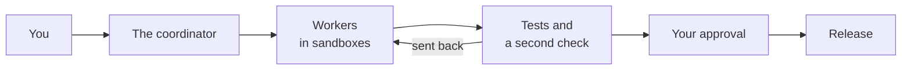

# Hansa Agents

[简体中文](README.zh-CN.md)

**Hansa is a team of AI coding agents that builds and maintains your software product while you decide and approve.
You say what you want in plain language; agents from several model makers build, test and check each other's work,
and nothing ships until you approve it, each time or in advance.**

It runs on a machine you control that stays on, such as a Mac mini at home or a rented Linux server, and you reach it
over SSH from wherever you are. It is not a hosted service: the desk, its keys and its logins live on that machine.

- **Status:** Alpha, `0.5.0a1`: settings, commands and files may still change. Up to 0.4 the project was called Bellhop.
- **Runs on:** macOS or Linux, with Python 3.9 or newer, git and Claude Code; [`hansa doctor`](#quick-start) checks the machine
- **Interfaces:** The `hansa` menu and command; a web page reached through an SSH tunnel (a private link from your computer)
- **License:** MIT

## Who it is for

**First, people who run a product but do not write code:** founders, studio owners, product leads. You talk to one
agent, the **coordinator**, which asks when something is unclear, suggests improvements and turns your wishes into
tasks. Day to day you get:

- a web page that shows the work under way, what waits for you, and what the work has cost;
- alerts on your phone or in your team chat (Bark, ntfy, Telegram, Slack, Discord, WeCom, DingTalk, Feishu and more:
  [Push services](docs/push-services.md));
- approvals: releases wait for your yes, or for a target you approved in advance;
- several products on one machine: one **desk** (a folder with a team's settings, tasks and history) per product, and
  one machine can run several desks for weeks with nobody watching.

**Second, developers** with more work than one agent session can handle.

**Not for:**

- An editor plug-in or a pair-programming chat. You hand Hansa work and come back to results.
- A hosted, mobile or remote-control product. Hansa runs on your own machine; your phone gets alerts and the page.
- Iterating on screen designs. Do that elsewhere, then hand the finished design to Hansa as a task's input.

## Quick start

```sh
curl -fsSL https://raw.githubusercontent.com/FrostNovaOrg/Hansa/main/install.sh | sh
hansa doctor
hansa init ~/shop/desk --repo ~/shop/repo
hansa
```

If your shell cannot find `hansa`, add the `export PATH` line the installer printed.

Or open Claude Code on that machine and ask it to follow [SETUP.md](SETUP.md): it sets Hansa up with you, one question at a time.

`~/shop/repo` is your project's git repository and needs at least one commit; `~/shop/desk` is the new desk. [Getting started](docs/getting-started.md) covers the rest.

## How it works



A **worker** is an agent that does one task in a fenced-off space (a sandbox), on its own copy of your code. A **lane**
is one such copy with its own rules: which model providers it uses, which hosts it may reach, its tests (its check)
and how it releases.

1. **The coordinator queues a task** (`hansa add`): one change a worker can make and check on its own.
2. **`hansa serve` stays running and starts it** on a free lane: a worker makes the change in its sandbox and reports.
3. **hansa commits and checks.** It runs the lane's tests itself, so the result does not depend on the worker's report.
4. **The coordinator reviews.** For code, another worker tries the change to see whether it holds (`hansa verify`);
   the coordinator then merges it or sends it back.
5. **You release.** hansa merges into the lane's base branch, where its work lands, and stops. It runs the lane's
   release command, such as a deploy, only after your approval or for a target you approved in advance.

Developers: [How work moves](docs/concepts.md#how-work-moves) has the detailed chart.

## Several models, on purpose

A lane can use a Claude Code login, any endpoint that speaks the Anthropic API (for example DeepSeek's or Kimi's), or,
on macOS, Codex's command line through [`contrib/codex`](contrib/codex/README.md). One model can write a change and
another check it, and a provider at its usage limit hands its task to the next. The page totals the cost of all of them in one
place, and `hansa cost --by provider` breaks it down by provider.

## What it has done

Hansa is developed with Hansa. These figures come from one desk over the 60 days ending 2 November 2026; yours will differ.

| Measure | Figure |
|---|---|
| Changes merged | 345 |
| Merged without being sent back | 57% |
| Verifications that said "does not hold" | 37% |
| Cost per merged change, at list prices | US$8.65, including coordinator, workers and verification |

With a subscription, your bill is the subscription fee; the figure values tokens at list prices.

## Your Claude Code, your login

Hansa runs the Claude Code you installed, using your own account or key to sign in. It does not include, change
or resell Claude Code. Worker usage counts against your own plan, under your provider's terms; heavy use reaches a
plan's limits sooner. Do not let other people use a desk through your subscription login: Anthropic's usage policy
does not allow services that route requests through consumer plans. Hansa is an independent project, not affiliated
with or endorsed by Anthropic or OpenAI.

## What keeps it safe

- **Workers run in the operating system's sandbox.** They write only where their lane allows, reach only the hosts it
  lists, and cannot read the desk's keys; web tools you allow on a lane run outside that list.
  [Workers and the sandbox](docs/sandbox.md)
- **The coordinator is not sandboxed.** Claude Code asks you before each command not already allowed, and rules deny
  key access and direct code edits. Rules against pushing catch only the forms they name; for the rest, Claude Code
  asks you first. [Who changes what](docs/who-changes-what.md)
- **Releases wait for you**, or for a target you approved in advance. They run outside the sandbox, with the desk
  account's logins. [Releases and alerts](docs/releases.md)
- **Keys stay out of sight.** They live in `secrets/`, readable by hansa's account, and go only to the provider. hansa
  hides keys wherever they might appear and refuses to merge one, but cannot see into compressed files.
  [The desk](docs/desk.md#where-a-desks-files-are)
- **The page is private by default.** It listens only on the machine itself and needs the token in the address
  `hansa web` prints. `hansa serve --host` can open it wider; whoever holds that address can approve a release.
  [The token](docs/who-changes-what.md#a-claude-code-sessions-identity-and-the-pages-token)

More: [Limits](docs/concepts.md#limits).

## Documentation

You do not need to read hansa's code to use it.

### Start here

| Document | What is in it |
|---|---|
| [Getting started](docs/getting-started.md) | Install, log in, create a desk, reach its page over SSH, finish the first task |
| [SETUP.md](SETUP.md) | For your Claude Code: say "read SETUP.md and set up Hansa with me" |
| [Concepts](docs/concepts.md) | Key terms, how work moves, the desk's files, macOS and Linux, limits, commands, upgrading |
| [How a desk is run](docs/principles.md) | The rules for running hansa, what enforces them and what they guard against |
| [Push services](docs/push-services.md) | Alerts to phones and chats: Bark, ntfy, Telegram, Slack, WeCom, DingTalk, Feishu and more |

### Reference

| Document | What is in it |
|---|---|
| [`hansa/card.md`](hansa/card.md) | The coordinator's standing instructions and every command; each desk holds a copy as `CLAUDE.md` |
| [Who changes what](docs/who-changes-what.md) | What you set on the page, what the coordinator sets, and what stays closed to it |
| [Workers and the sandbox](docs/sandbox.md) | What workers and verifiers may touch, write lists, allowed hosts, refused paths |
| [How a task runs](docs/tasks.md) | Time limits, resuming, retries after a dropped connection, providers' usage limits |
| [Releases and alerts](docs/releases.md) | Release targets, one-time codes, stopping a release, your alert command |
| [On a Linux server](docs/linux-server.md) | The coordinator as root, the desk as an ordinary account, Linux's sandbox |
| [Java and Maven in a lane](docs/java-and-maven.md) | Maven and Java in the sandbox, effects on build scripts, project requirements |
| [The desk: files, keys and notes](docs/desk.md) | Keys, the coordinator's rules and notes, free space, which desk files grow |
| [CHANGELOG.md](CHANGELOG.md) | Changes by version, including Bellhop's |
| [CONTRIBUTING.md](CONTRIBUTING.md) | How to change hansa, and the licensing of contributions |

`hansa help <topic>` prints a page from `docs/` in the terminal; `hansa help card` prints the card.

## Contributing and license

To change hansa, read [CONTRIBUTING.md](CONTRIBUTING.md).

[MIT](LICENSE). Copyright (c) 2026 FrostNovaOrg.
