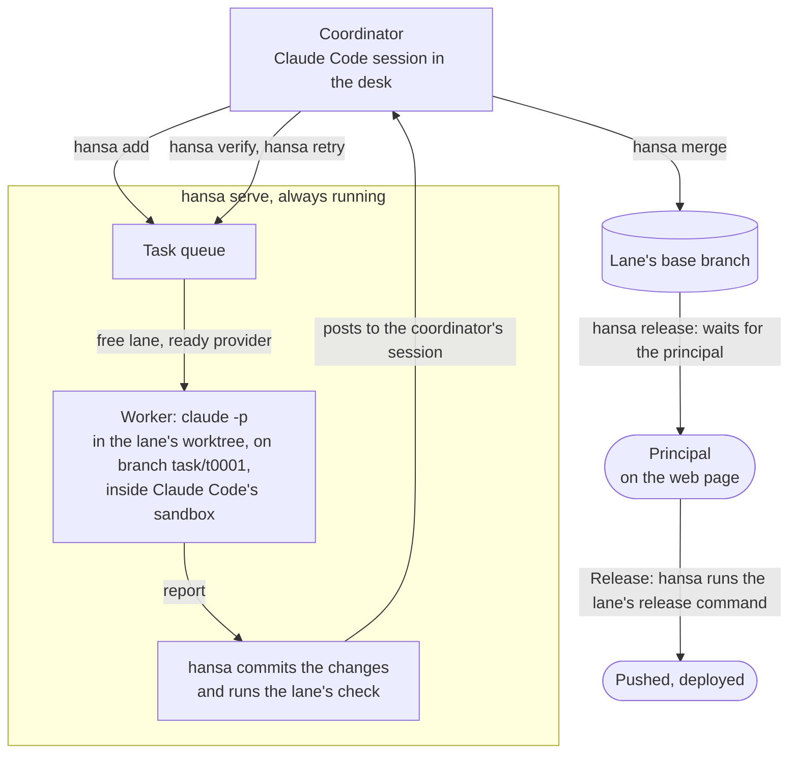

# Hansa Agents

**A small team of Claude Code agents, organized like a company.**

A coordinator session plans the work and queues tasks. Each task goes to a worker: one `claude -p` run in
the operating system's sandbox, in its lane's git worktree, on a branch of its own. hansa commits the
worker's changes, runs the lane's check and keeps the record. A person, the principal, owns the providers,
keys and settings through a local web page, and hansa releases nothing without the principal's yes: given
for each release, or once for a release target the principal lets go out without asking.
A worker may also run Codex's command line instead, through the optional adapter in
[`contrib/codex`](contrib/codex/README.md) (macOS only), which also has a Cursor backend, off by default.

| | |
|---|---|
| **Status** | Alpha, `0.5.0a1`, unreleased: settings, commands and files may still change. A rewrite, much smaller than 0.4; up to 0.4 the project was called Bellhop, and that version is on the `main` branch. |
| **Runs on** | macOS or Linux, with Python 3.9 or newer, git and Claude Code |
| **Install** | Nothing to build: Python's standard library only, run from a checkout |
| **Interfaces** | A local web page for the principal; the `hansa` command for the coordinator |
| **License** | Apache-2.0 |

[How it works](#how-it-works) · [Where hansa sits](#where-hansa-sits) · [Key terms](#key-terms) · [Quick start](#quick-start) ·
[Commands](#everyday-commands) · [Safety](#what-keeps-it-safe) · [Limits](#limits) ·
[Documentation](#documentation)

## How it works



1. **The coordinator queues a task** (`hansa add`): one change a worker can make and check on its own.
2. **`hansa serve` starts it** on a free lane: a fresh `claude -p` run in the lane's worktree, on a branch
   `task/<id>`, inside Claude Code's sandbox. The worker changes files there and ends with a short report.
3. **hansa commits and checks.** Workers do not commit: hansa commits their changes on the branch, then
   runs the lane's check itself, so the result does not depend on what the worker says. It then tells the
   coordinator's session that the task ended.
4. **The coordinator reviews**: `hansa show` and `hansa diff`, and `hansa verify` to have another worker run
   the change and see whether it holds. Then `hansa merge`, or `hansa retry` with what to change. When the base
   branch gained commits the task's branch lacks and the lane has a check, hansa checks the two together first.
5. **The principal releases.** hansa merges into the lane's base branch and stops there. `hansa release`
   asks the principal, who answers on the page, or in the conversation with the one-time code their alert
   carried. Only after the yes (or for a target the principal ticked to go out without asking) does hansa
   run the lane's release command: a push, a wait for CI, a deploy.

## Where hansa sits

hansa is built around isolation. Workers run in the operating system's sandbox, each in its own worktree; the principal reaches them only through the coordinator and the page. The coordinator is the one session that talks to the principal, and it does not do the detailed work itself: it plans, queues, reviews and merges.

Because of that, hansa is not the place to design a feature interactively. Design happens where real-time collaboration works well: a desktop assistant, a prototyping site, a design tool. When the design is settled, hand the result to hansa as the task's input: a published demo site, a document, a set of screens. The workers build from it.

hansa also keeps running: its server dispatches work, runs checks and merges around the clock. It belongs on a machine that stays on, a Mac mini, a home server, a Linux box, not on the laptop you close at night.

## Key terms

| Term | What it is |
|---|---|
| **Principal** | The person the desk works for. On the web page they set providers, keys, models and prices, answer the agents' requests, and approve or refuse releases (a release can also be answered in the conversation, with the one-time code the principal's alert carries). |
| **Coordinator** | An interactive Claude Code session in the desk (`hansa coordinator`). It plans, queues, reviews and merges work through `hansa`, and sets up the lanes. It runs outside the sandbox, so it can install what a lane needs; Claude Code asks the principal before each command not already allowed. Its interface is [`hansa/card.md`](hansa/card.md), and `hansa help` for the rest. |
| **Helpers** | Three subagents in the coordinator's session: `scout` (looks something up) and `reviewer` (reads a high-stakes change) only read; `operator` does one hands-on job on the machine, such as installing software. |
| **Worker** | One `claude -p` run per task, or per verification (`hansa verify`). It may run any command, inside Claude Code's sandbox: its commands write only in its worktree and the folders its lane allows, and reach only its lane's hosts. It never commits. |
| **Desk** | One folder that holds a team's settings, keys, tasks and an append-only event log. The command line, the web page and the agents all read the same files. |
| **Lane** | A git checkout the workers work on: its base branch, a worktree of its own, its provider order, the hosts and folders its workers may reach, and its setup, check and release commands. A lane runs one task at a time; lanes on the same repository run tasks side by side, up to `hansa concurrency`. |
| **Provider** | Where a run's model comes from: a Claude Code login (a subscription), or any endpoint that speaks the Anthropic API, with its key. A provider that hits its usage limit rests, and its task moves to the lane's next ready provider, or waits for one. |
| **Check** | A lane's test command. hansa runs it on each task's branch, in the lane's sandbox; a failed check blocks the merge unless the coordinator overrides it, which is recorded. |
| **Release** | Sending a lane's base branch out through one of its named release targets, after the principal's yes. It runs outside the sandbox, as the desk's account. |

## Quick start

Working as root on a Linux server? Read [On a Linux server](docs/linux-server.md) before you start: Claude
Code's sandbox cannot start as root, so there the desk, the lanes' repositories and hansa's own checkout
belong to, or are readable by, an ordinary account, and the steps below change accordingly.

### 1. What you need

- **macOS or Linux** with Python 3.9 or newer, git and [Claude Code](https://code.claude.com/docs/en/overview).
- **Claude Code's sandbox**, which every worker runs in; a worker does not start without it. It is built
  into macOS; on Linux it needs `bubblewrap` and `socat`, and on Ubuntu 24.04 and later the system's
  AppArmor rules can stop it (see Claude Code's [sandboxing documentation](https://code.claude.com/docs/en/sandboxing#set-up-linux-and-wsl2)).
- **`srt`**, [Anthropic's sandbox runtime](https://github.com/anthropics/sandbox-runtime), for any lane with
  a setup or check command: hansa runs those in the lane's sandbox with it.
  `npm install -g @anthropic-ai/sandbox-runtime`; srt is a node script, so node must be on the `PATH` of
  `hansa serve`. Without it, a lane's setup fails each task before its worker starts, and its check reads
  "could not run" without judging the task; `hansa status` says so.

### 2. Get hansa

```sh
git clone https://github.com/FrostNovaOrg/Hansa.git ~/hansa
export PATH="$HOME/hansa/bin:$PATH"     # add this line to your shell's profile too
hansa --version
```

Put the `bin` folder itself on your `PATH`, not a link to `bin/hansa` in another folder: the script finds
hansa's code from the path it was started by, without following links, so through a link it fails with
`No module named hansa`.

### 3. Make a desk and keep the server running

```sh
hansa init ~/desk --repo ~/code/myproject   # the first lane, "a", on the checkout's current branch
cd ~/desk && hansa up                     # starts the server, then the coordinator (step 5); tmux when installed
```

The repository needs a first commit: `hansa init` and `hansa lane add` refuse one without. hansa also
refuses a desk, home folder, repository or worktree whose path holds one of `[ ] * ? \`, and a desk or
repository whose path holds a `)` followed later by a space or a comma: its rules for the sandbox would
read them as patterns or split them ([Paths hansa refuses](docs/sandbox.md#paths-hansa-refuses)).
A desk has one `hansa serve`. More than one desk on a machine: each desk's `hansa serve` needs its own port
(`hansa serve --port 8766`), and that desk's `hansa web` finds it.

### 4. Open the page and add providers

```sh
cd ~/desk && hansa web     # prints the page's address, with a token; keep this terminal open
```

Run `hansa web` and `hansa serve` from a terminal of your own, not from a Claude Code session: `hansa web`
refuses there, as the token would land in the session's context, and `hansa serve` drops the session's
identity from its environment and says so ([details](docs/who-changes-what.md#a-claude-code-sessions-identity-and-the-pages-token)).

From your own computer, open the page of a desk on another machine through an SSH tunnel (for a desk on
another port, tunnel that port instead):

```sh
ssh -L 8765:127.0.0.1:8765 HOST /path/to/hansa/bin/hansa --desk /path/to/desk web
```

`hansa status` and `hansa explain server` say the address and port the page is served on, and whether
`hansa serve` serves it now. On the page, under Settings, add providers (a Claude Code login, or any endpoint that speaks the
Anthropic API, with its key), their models and effort defaults, and the prices hansa counts tokens at. A new
desk starts with one provider, `claude`: the Claude Code login of the account hansa runs as.
`hansa ping [PROVIDER]` sends one tiny request through a provider (all when omitted) to see that it answers.
Run from a shell, it uses the `claude` program the recorded `hansa serve` start used, not whichever one that
shell would find, and says so when the two differ. The page follows the browser's language: English, or Chinese.

### 5. Start the coordinator

`hansa up` starts the coordinator's session too, in tmux, and prints how to attach to it; after a restart it
starts the session again as it last started, continuing its conversation. `hansa coordinator` stays the way
to run it in the current terminal instead (one or the other: both would be two coordinators):

```sh
tmux -L hansa-desk attach -t coordinator    # the session hansa up started, as it printed
cd ~/desk && hansa coordinator              # or run it in this terminal
```

The first time Claude Code opens in a new desk, it asks whether you trust the folder: choose yes. Claude
Code ignores the allowed commands of a folder it does not trust, and the coordinator could not run `hansa`.

Then tell the coordinator what you want built. It sets up the lanes and how many tasks run at once
(`hansa lane`, `hansa concurrency`) and queues the work. hansa tells the coordinator's session when a task
ends or you answer a request, through the session's inbox (`hansa notify` shows which sessions it posts
to). If your Claude Code settings hold messages from other sessions (`crossSessionInbound`), the coordinator
does not hear it; only you can change that.

## Everyday commands

The coordinator runs these; you can run them too. Every coordinator command is in
[`hansa/card.md`](hansa/card.md), which `hansa help card` prints; `hansa help` alone lists the commands and
the topics, and `hansa help <topic>` prints one from `docs/`. `hansa --help` lists every command, the
principal's (`init`, `serve`, `web`, `coordinator`, `ping`) among them, and `hansa <command> --help` (or
`hansa help <command>`) gives all of a command's options.

| Command | What it does |
|---|---|
| `hansa status` | Whether `hansa serve` runs, the page's address, the lanes, what runs, waits or failed, the providers, the last 24 hours |
| `hansa add "<task>" [--lane L]` | Queue a task |
| `hansa show ID`, `hansa diff ID` | A task's report, its check, the files it changed, what to do next; its changes against the base |
| `hansa verify ID` | Have a worker run a finished task's change to see whether it holds; never merged |
| `hansa merge ID` | Merge a finished task into its lane's base branch |
| `hansa retry ID "<what to change>"` | Queue a follow-up on top of the earlier task (`--fresh`: from the base; `--update`: with the base merged in) |
| `hansa cancel ID`, `hansa close ID` | Stop queued, running or merging work; close finished work without merging |
| `hansa release L [TARGET] ["<note>"]` | Ask for a release of lane L's base branch; it runs after the principal's yes (a target ticked to go out without asking needs none) |
| `hansa release yes\|no ID CODE` | Pass on the principal's answer to a release, given in the conversation with their alert's one-time code |
| `hansa lane ...`, `hansa concurrency [N]` | List, add, change or remove lanes; how many tasks run at once |
| `hansa ask "<request>"` | Put a request on the principal's page |
| `hansa cost [--by day\|seat\|lane\|task\|model\|provider]` | Tokens, and what they are worth at the principal's prices |
| `hansa explain [lane L \| provider P \| server \| notify]` | This desk's current settings and state, and where each comes from |

## Upgrading and going back

**Upgrading.** In the desk, run `hansa pause "upgrade"` to keep new work from starting while
running work finishes. `hansa status` lists what runs; wait until nothing runs.

In hansa's clone, record `git rev-parse HEAD` for going back, then run `git fetch origin` and
check out the version you want. `git checkout --detach COMMIT` runs one fixed commit.

Restart `hansa serve` to run the new code. For a server `hansa up` started, stop the server
with `kill PID` using the pid it printed, then run `hansa up` in the desk. It leaves running
servers alone. For one started by hand, press Ctrl-C and rerun its `hansa serve` command
with the same options.

Server startup updates the card. The coordinator reads it at session start, after `/clear`
or after compaction; changes to its permissions, helpers, mod or launch options need a
session restart. See [Starting the server and the coordinator again](docs/desk.md#starting-the-server-and-the-coordinator-again).
Then run `hansa resume`. The first line of `hansa status` shows the version and when it was installed.

**Going back.** Follow the same steps with the commit you ran before. Newer commands may
write settings older code does not know: `hansa status` and `hansa add` can still work, but
saving settings is refused with `unknown setting: NAME` for each unfamiliar setting.
Settings set with newer commands are best undone before going back.

**What changed:** in the clone, run `git log --oneline OLD..NEW`.

## What keeps it safe

- **Workers' commands run in the operating system's sandbox.** A worker may run any command, but its
  commands write only its worktree, its own temporary folder and the lane's write list; they reach no network
  but the lane's network list; they cannot read the desk's keys and state, any provider's Claude Code folder
  or `~/.claude`, the logins, keys and histories hansa knows under the home folder, or what the principal
  lists on the page; and git history is left to hansa. The lane's setup and check run in the same sandbox.
  Ways out of the network list are the principal's to see: a lane's allow list may give its workers Claude
  Code's web tools (`WebFetch` site by site, `WebSearch`), which run in Claude Code's own process; every
  change of that list is recorded. More: [Workers and the sandbox](docs/sandbox.md).
- **The coordinator works in the open.** It is not sandboxed, but Claude Code asks the principal before each
  command not already allowed. Its permission rules keep three things closed to it: reading the keys in
  `secrets/`; reading or editing the files directly in the Claude Code folder it runs from (its login among
  them) and its `sessions/`; and editing code in the lanes' repositories, so code changes go through workers
  and each gets a branch, the lane's check and a merge. They also deny pushing and publishing from its own
  shell (`git push`, `npm publish`, `mvn deploy` and more; the full list is in [Who changes what](docs/who-changes-what.md#the-coordinator)), with
  options, subcommands, a build wrapper, or `xargs` or `env` in front, but run another way (`bash -c "git push"`, a
  script), such a command is not caught, and only Claude Code's own asking puts it before the principal. More: [Who changes what](docs/who-changes-what.md).
- **Nothing goes out without the principal.** hansa merges into a lane's base branch and stops there. A
  release runs only after the principal's yes, on the page or by the one-time code that only their alert
  carries, or for a target the principal ticked to go out without asking; only while the base branch and
  the command are still what the principal saw; and it is refused when its command or an outgoing commit
  holds one of the principal's forbidden words. Your alert command must not keep the alert's text anywhere
  the coordinator can read it (a file, a log, a chat history): the code in it approves a release. A release
  runs outside the sandbox, as the desk's account with its logins, so a change to the files a lane lists as
  built and run by its releases (`release_files`) merges only once a verification of it holds.
  More: [Releases and alerts](docs/releases.md).
- **Keys stay out of sight.** They live in the desk's `secrets/` (mode 600) and go only to the provider's
  endpoint, as that worker's environment. hansa replaces a key with `[key of <provider>]` wherever it would
  show, and refuses to merge a change that holds one.
- **The page is local.** `hansa serve` serves it on 127.0.0.1 by default; its data and actions require the token
  in the address `hansa web` prints.

Each of these has limits; they are listed under [Limits](#limits) and in the documents linked above.

## macOS and Linux

| | macOS | Linux |
|---|---|---|
| Workers' sandbox | Built in | Needs `bubblewrap` and `socat`; AppArmor on Ubuntu 24.04 and later can stop it |
| `localhost` on a lane's network list | Needed for workers' own local servers, but opens every service on the machine's loopback: list it only when nothing there must be kept from workers | Leave it off: each sandbox has a loopback of its own, and it would only open the machine's loopback through the sandbox's proxy |
| What a build meets in the sandbox | `mktemp` ignores `TMPDIR` unless given a template there, and is refused: [Java and Maven in a lane](docs/java-and-maven.md) | The mount table can call a writable folder read-only, and git there leaves out the sandbox's placeholder files: [On a Linux server](docs/linux-server.md#what-a-lanes-commands-meet-in-linuxs-sandbox) |
| As root | — | The coordinator may run as root, with the desk owned by an ordinary account: [On a Linux server](docs/linux-server.md) |

## The desk

Everything a desk holds is plain files in one folder:

```text
desk/
├── settings.json          the principal's settings (set on the page) and the lanes (the coordinator's)
├── secrets/               provider keys; written by the page, never shown
├── CLAUDE.md              the card, a copy of hansa/card.md
├── .claude/               the coordinator's permission rules and helpers (your own rules: settings.local.json)
├── lanes/<lane>/brief.md  standing instructions sent to every worker in a lane
├── tasks/<id>/            each task's text, record and report, and what its processes wrote, keys removed
├── worktrees/<lane>/      one git worktree per lane
├── notes/                 the coordinator's notes; notes/PROJECT.md holds the project's own rules
├── events.jsonl           append-only record of everything that happened
├── asks.json              requests from the agents to the principal
├── PAUSED                 present: no new work starts
└── .hansa/                runtime state: providers' rests, the heartbeat, the page's token and port, releases
```

More: [The desk: files, keys and notes](docs/desk.md).

## Limits

- Alpha: settings, commands and files may still change between versions.
- A worker's commands and the lane's setup and check run in the operating system's sandbox. The coordinator
  runs as the desk's user (or as root on a Linux server). Run a desk as a user, or on a machine, whose files
  you are content for that code to reach.
- With the [Codex adapter](contrib/codex/README.md), a Codex run's commands can read the Codex login: Codex and
  the commands it runs share one sandbox, and every Codex run, on any lane, uses that one login. Claude workers
  cannot read it, and a Codex run's network reaches only the lane's hosts and OpenAI's.
- With the adapter's [Cursor backend](contrib/codex/README.md#the-cursor-backend), Cursor runs outside the
  operating system's sandbox and its commands in Cursor's own, which lets them write the git folder of any
  repository the workspace's `.git` is pointed at, the lane's included. The adapter keeps the lane's git folders
  read-only for the run and fails a run that changed them, but a commit that landed there stays.
- A release's command runs outside the sandbox, as the desk's account, and so does what it builds and
  starts from the base branch: list a lane's build and release files as its `release_files`.
- The coordinator's rules against pushing and publishing catch only the forms they name; a command run another
  way waits for the principal only where Claude Code asks before running it.
- hansa replaces the principal's keys wherever it shows or records text, and will not merge a change that
  holds one. It cannot see into compressed files, and the event log keeps what it recorded before a key was
  saved.
- When a run ends, hansa stops what it left running, but a process that moved out of every marker between
  two of `hansa serve`'s rounds, and whose parent ended before the next one, can escape: see
  [what hansa stops when a run ends](docs/sandbox.md#what-hansa-stops-when-a-run-ends).
- A lane repository's merge hooks run while `hansa merge` holds the desk, so `hansa serve` waits for them.
- One `hansa serve` per desk, on one machine.

## Documentation

Nobody reads hansa's code to use it. If the card, a `hansa help` topic or a command's output is not enough,
fix that.

| Document | What is in it |
|---|---|
| [`hansa/card.md`](hansa/card.md) | What the coordinator needs on every turn: how work moves, every command, what it may change; `hansa help <topic>` prints the rest from `docs/`. `hansa help card` prints it, and each desk holds a copy as `CLAUDE.md`. |
| [Who changes what](docs/who-changes-what.md) | What the principal sets on the page and the coordinator with `hansa`: lanes, commit messages and identity, what stays closed to the coordinator |
| [Workers and the sandbox](docs/sandbox.md) | What workers and verifiers may touch; git's folders; the sandbox probe; write lists and env; the allow list and its web tools; paths hansa refuses; what hansa stops when a run ends |
| [How a task runs](docs/tasks.md) | Time limits and resumes, retries after a dropped connection, providers' usage limits |
| [Releases and alerts](docs/releases.md) | Release targets, answers by one-time code, files a release runs, stopping a release, the principal's alert command |
| [On a Linux server](docs/linux-server.md) | The coordinator as root, the desk as an ordinary account; what a lane's commands meet in Linux's sandbox |
| [Java and Maven in a lane](docs/java-and-maven.md) | What hansa sets up for Maven and Java in the sandbox, what that changes for a build script (`mktemp` on macOS too), and what a project and its lane need |
| [The desk: files, keys and notes](docs/desk.md) | Keys, the coordinator's permission rules and notes, the project's own rules, what the coordinator's session leaves out, the floor of free space, where a desk's files grow |
| [CHANGELOG.md](CHANGELOG.md) | What changed in each version, Bellhop's included |
| [CONTRIBUTING.md](CONTRIBUTING.md) | How to change hansa, and the licensing of contributions |

## Development

hansa is developed with hansa: the `tNNNN: <title>` and `Merge tNNNN: <title>` commits in its history are a
desk's task commits and merges.

`python3 tests/run_parallel.py` runs the suite faster across processes;
`python3 -m unittest tests.test_hansa` still works (both use a stand-in for `claude`; no model is called).
Before each push the maintainers run the whole suite on macOS and on Linux. Every push to `alpha` or `main`
runs, on GitHub's Ubuntu machine, the tests a sandboxed run cannot (those that listen on the loopback or make a
Unix socket); every pull request runs the whole suite on Ubuntu, with Python 3.9 and the newest. Only a run
started by hand adds macOS and the real sandbox on it; start one before a release whose changes touch the
sandbox or the web page: `.github/workflows/tests.yml`. Before you change anything, read [CONTRIBUTING.md](CONTRIBUTING.md).

## License

Hansa is licensed under the [Apache License, Version 2.0](LICENSE).

`SPDX-License-Identifier: Apache-2.0`

Copyright (c) 2026 FrostNova.
