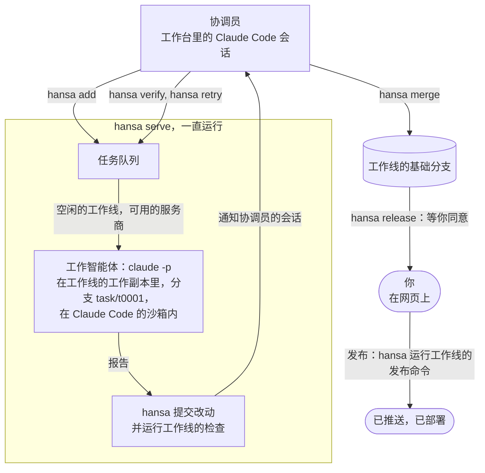

# Hansa Agents

[English](README.md)

**你只需提出需求，并确认哪些改动可以发布；一支编程智能体团队负责规划、开发、测试，并互相检查工作，全部跑在你掌控的机器上。**

你只和一个智能体打交道：协调员。它把工作拆成一件件任务，每件任务交给一个工作智能体，在独立的沙箱和独立的代码分支里完成。Hansa 负责提交改动、运行你的测试，再由另一个工作智能体实际试一遍这处改动，协调员据此决定合并还是返工。每次发布都要你同意，也可以事先批准。

- **状态**：Alpha 版，`0.5.0a1`，设置、命令和文件都还可能变。0.4 及以前，这个项目叫 Bellhop。
- **运行环境**：macOS 或 Linux，需要 Python 3.9 以上、git 和 Claude Code；可以用 [`hansa doctor`](#快速开始) 检查这台机器是否满足。
- **使用方式**：`hansa` 菜单和命令，以及一个经 SSH 隧道打开的网页。
- **许可证**：MIT

## 适合谁

**适合：**

- 管产品、不写代码，想要一支智能体团队替自己开发的人。
- 活多到一个智能体会话忙不过来的开发者。

**不适合：**

- 边聊边设计功能。设计请在别处做完，再把结果当作任务的材料交给 Hansa。
- 晚上要合上的笔记本电脑。Hansa 应该放在一直开着的机器上，比如 Mac mini、家里的服务器或一台 Linux 主机。你在哪里都能用 SSH 和 tmux 连上它，断开以后它照常运行。

## 快速开始

```sh
curl -fsSL https://raw.githubusercontent.com/FrostNovaOrg/Hansa/main/install.sh | sh
hansa doctor
hansa init ~/shop/desk --repo ~/shop/repo
hansa
```

如果提示找不到 `hansa`，按安装程序的提示，加上它打印的那行 `export PATH`。

`~/shop/repo` 是你项目的 git 仓库，里面至少要有一次提交；`~/shop/desk` 是新建的工作台，团队的设置和任务都放在这里。后面的步骤见[上手指南](docs/getting-started.md)。

## 工作原理

每条工作线是你代码的一份工作副本，有自己的一套规则：用哪些模型服务商、能访问哪些主机、跑哪些测试（叫作这条工作线的检查）、怎么发布。



1. **协调员把任务排进队列。** 每件任务只做一处改动，工作智能体能独立完成并自己检查。
2. **一直运行的 `hansa serve` 把任务派给空闲的工作线。** 工作智能体在沙箱里改好，写一份报告。
3. **Hansa 提交并检查。** 测试由 Hansa 自己运行，结果不取决于工作智能体的报告。
4. **协调员审查。** 改了代码的，另派一个工作智能体实际试一遍，看改动是否站得住；协调员据此合并或返工。
5. **由你发布。** Hansa 把改动合并进工作线的基础分支后就停下。只有你同意了，或者这个发布目标已事先批准，它才运行发布命令，比如部署。

## 有意用多家模型

一条工作线可以用 Claude Code 的登录、任何兼容 Anthropic API 的接口（比如 DeepSeek 或 Kimi 的），在 macOS 上还可以通过 [`contrib/codex`](contrib/codex/README.md) 用 Codex 的命令行。核验可以交给另一家模型，不必是写这处改动的那一家；某家服务商的用量到了上限，任务会转给下一家。

## 它做过什么

Hansa 本身就是用 Hansa 开发的。下面的数字来自一个工作台截至 2026 年 11 月 2 日的 60 天，你的数字会不一样。

| 指标 | 数值 |
|---|---|
| 合并的改动 | 345 件 |
| 无需返工即可合并的改动 | 57% |
| 判为“未通过”的核验 | 37% |
| 每合并一件改动的成本（按官方标价） | US$8.65，协调员、工作智能体和核验的用量全部算在内 |

用订阅的话，实际账单就是订阅费；这里的金额是把用掉的 token 按官方标价折算出来的。

## 你的 Claude Code，你的登录

Hansa 运行的是你自己安装的 Claude Code，用你自己的账号或密钥登录。它不附带、不修改、也不转售 Claude Code。工作智能体的用量算在你自己的套餐里，适用你所用服务商的条款；用得多，会更早碰到套餐的上限。不要用你的订阅登录给别人提供工作台：Anthropic 的使用政策不允许借消费者套餐转发请求的服务。Hansa 是独立项目，与 Anthropic 和 OpenAI 都没有隶属关系，也没有得到它们的认可。

## 安全靠什么

- **工作智能体跑在操作系统的沙箱里。** 它们的命令只能写工作线允许的位置，只能连工作线列出的主机，也读不到工作台的密钥；你在工作线上允许的网页工具不受这份主机名单限制。[工作智能体与沙箱](docs/sandbox.md)
- **协调员不在沙箱里。** 尚未获准执行的命令，Claude Code 都会先问你；另有规则禁止它读取密钥、直接改代码。禁止推送的规则只拦得住其中写明的那些写法，其余写法就靠 Claude Code 先问你这一关。[谁改什么](docs/who-changes-what.md)
- **发布要等你。** 只有你同意了，或者这个发布目标已事先批准，发布才会运行。发布在沙箱外运行，用的是工作台所在账号的登录信息。[发布与提醒](docs/releases.md)
- **密钥不外露。** 密钥存放在 `secrets/` 里，Hansa 所用的账号读得到，只发给对应的服务商。Hansa 会在可能显示密钥的地方把它隐去，含密钥的改动一律不合并，但它看不到压缩文件里面的内容。[工作台](docs/desk.md#where-a-desks-files-are)
- **网页默认不对外。** 它只监听本机，查看数据和执行操作都要用 `hansa web` 打印的地址里的令牌。`hansa serve --host` 可以把它开放给更大的范围，那时拿到这个地址的人就能批准发布。[令牌](docs/who-changes-what.md#a-claude-code-sessions-identity-and-the-pages-token)

更多见[限制](docs/concepts.md#limits)。

## 文档

用 Hansa 不需要读它的代码。

| 文档 | 内容 |
|---|---|
| [`hansa/card.md`](hansa/card.md) | 协调员每一轮都要遵循的说明：工作怎么流转、全部命令、它能改什么。`hansa help <topic>` 打印 `docs/` 里的其他主题，`hansa help card` 打印这份说明。每个工作台里都有一份副本，名为 `CLAUDE.md`。 |
| [概念](docs/concepts.md) | 关键术语、工作台的文件、macOS 与 Linux、限制、命令、升级 |
| [上手指南](docs/getting-started.md) | 安装、登录、新建工作台、经 SSH 打开网页、完成第一件任务 |
| [SETUP.md](SETUP.md) | 写给智能体的安装说明，让它陪你装好 Hansa：对你的 Claude Code 说“读 SETUP.md，和我一起装好 Hansa” |
| [工作台怎么运转](docs/principles.md) | Hansa 的运行规则、由什么来执行，以及各自防范的问题 |
| [谁改什么](docs/who-changes-what.md) | 哪些设置由你在网页上改，哪些由协调员用 `hansa` 改：工作线、提交信息和身份，以及始终不对协调员开放的部分 |
| [工作智能体与沙箱](docs/sandbox.md) | 工作智能体和核验能碰什么；git 的文件夹；沙箱试跑；可写清单和环境变量；允许清单及其中的网页工具；Hansa 拒绝的路径；一次运行结束时 Hansa 会停掉什么 |
| [任务怎么运行](docs/tasks.md) | 时间上限和中断后接着做、断线后重试、服务商的用量上限 |
| [发布与提醒](docs/releases.md) | 发布目标、用一次性代码答复、发布时会运行的文件、中止发布、你的提醒命令 |
| [在 Linux 服务器上](docs/linux-server.md) | 协调员以 root 运行、工作台用普通账号；工作线的命令在 Linux 沙箱里会怎样 |
| [工作线里的 Java 和 Maven](docs/java-and-maven.md) | 沙箱里 Maven 和 Java 怎么设、对构建脚本的影响（包括 macOS 上的 `mktemp`）、对项目和工作线的要求 |
| [工作台：文件、密钥和笔记](docs/desk.md) | 密钥、协调员的权限规则和笔记、项目自己的规则、协调员会话里省去的内容、最低剩余空间、工作台里哪些文件会越来越大 |
| [CHANGELOG.md](CHANGELOG.md) | 每个版本改了什么，包括 Bellhop 时期的版本 |
| [CONTRIBUTING.md](CONTRIBUTING.md) | 怎么参与修改 Hansa，以及贡献内容的许可方式 |

## 参与贡献与许可证

想修改 Hansa，请先读 [CONTRIBUTING.md](CONTRIBUTING.md)。

[MIT](LICENSE)。Copyright (c) 2026 FrostNovaOrg.
