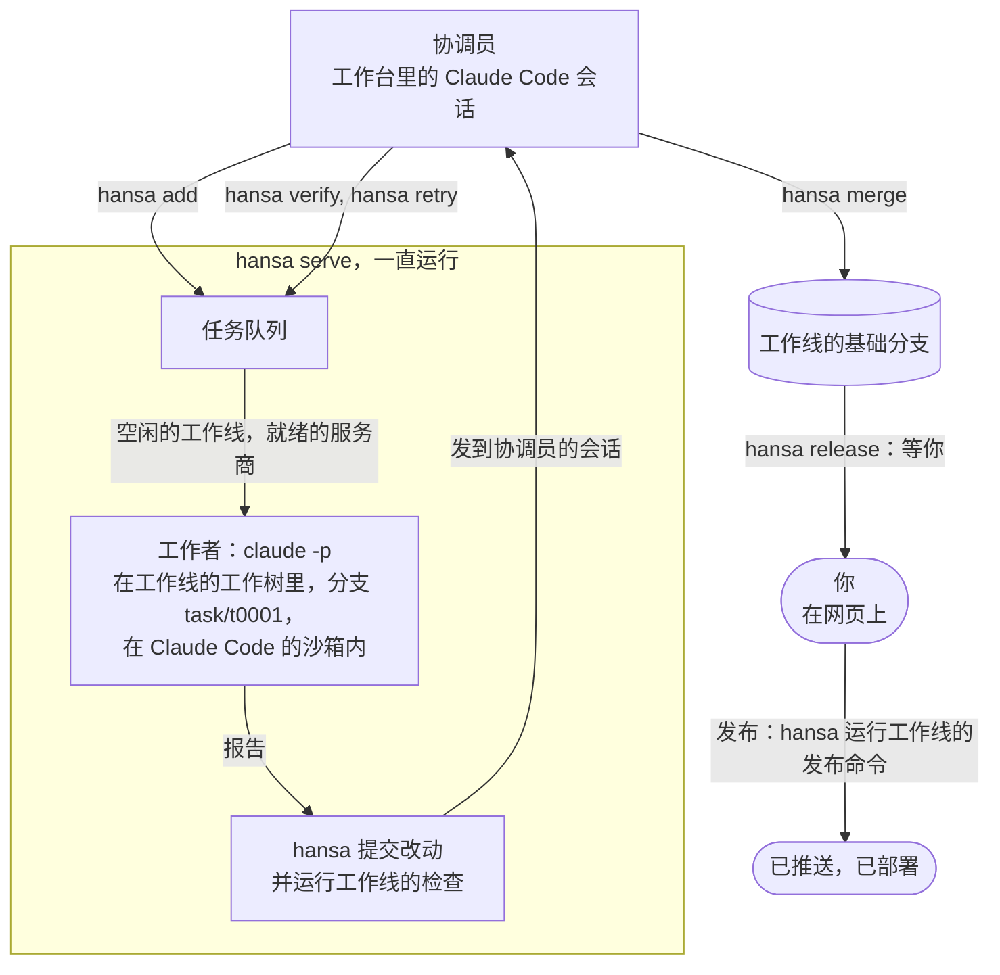

# Hansa Agents

[English](README.md)

**你说想要什么，批准要发出去的东西；一支写代码的智能体团队负责规划、开发、测试，并互相检查工作，全程在你掌控的机器上。**

你只跟一个智能体对话，也就是协调员。它把工作拆成任务，每件任务交给一个工作者（另一个智能体），工作者在自己的沙箱（一块隔离出来的空间）和自己的分支（你代码的一条独立副线）上工作。Hansa 提交结果（把改动存入版本记录）并运行你的测试；另一个工作者实际运行这处改动并核验，协调员再决定合并（并入你的代码）还是退回。每次发布都要你点头，你也可以事先批准。

| | |
|---|---|
| **状态** | Alpha，`0.5.0a1`：设置、命令和文件仍可能变化。0.4 及以前，这个项目叫 Bellhop。 |
| **运行环境** | macOS 或 Linux，需要 Python 3.9 或更新版本、git 和 Claude Code；[`hansa doctor`](#快速开始) 会检查这台机器 |
| **使用方式** | `hansa` 菜单和命令；通过 SSH 隧道（从你的电脑连过去的私密通道）打开的网页 |
| **许可证** | Apache-2.0 |

## 适合谁

**适合：**

- 负责产品但不写代码，希望使用智能体团队的人。
- 手头工作太多，一个智能体会话处理不完的开发者。

**不适合：**

- 边对话边设计功能：先在别处设计好，再把结果作为任务的输入交给 hansa。
- 晚上需要合盖的笔记本电脑。Hansa 适合放在一直开着的机器上，比如 Mac mini、家用服务器或 Linux 主机。你可以随时用 SSH 和 tmux 连接它：SSH 用来远程登录，tmux 会话在你断开后继续运行。

## 快速开始

```sh
curl -fsSL https://raw.githubusercontent.com/FrostNovaOrg/Hansa/main/install.sh | sh
hansa doctor
hansa init ~/shop/desk --repo ~/shop/repo
hansa
```

如果 shell 找不到 `hansa`，请添加安装程序打印的 `export PATH` 那一行。

`~/shop/repo` 是你项目的 git 仓库（存放代码和改动历史的地方），至少要有一次提交；`~/shop/desk` 是新的工作台，也就是存放你团队设置和任务的文件夹。其余内容见[上手指南](docs/getting-started.md)。

## 工作原理

工作线就是你代码的一份工作副本（它的工作树），并有自己的一套规则：用哪些模型服务商、能连哪些主机、跑哪些测试（它的检查）、怎么发布。



1. **协调员把任务排进队列**：每项任务只包含一处改动，工作者可以独立完成并检查。
2. **常驻程序 `hansa serve` 启动任务**，把它放到一条空闲的工作线上：工作者在沙箱里做改动，然后报告。
3. **hansa 提交并检查。** 它直接运行工作线的测试，不凭工作者的报告判断结果。
4. **协调员审查结果。** 另一个工作者实际运行代码改动并核验，协调员再决定合并还是退回。
5. **由你发布。** hansa 把改动合并进工作线的基础分支（它的工作最终落到的地方），然后停下。只有你点头，或你事先批准了发布目标，它才运行工作线的发布命令，比如部署。

## 多个模型，是有意为之

一条工作线可以用 Claude Code 登录、任何兼容 Anthropic API 的接口地址（例如 DeepSeek 或 Kimi 的），在 macOS 上还可以通过 [`contrib/codex`](contrib/codex/README.md) 用 Codex 的命令行。核验可以使用与编写改动不同的模型；一家模型服务商达到用量上限时，会把任务交给下一家。

## 它做过什么

Hansa 是用 Hansa 开发的。以下数据来自一个工作台，统计区间截至 2026 年 11 月 2 日，共 60 天；你的数字会不一样。

| | |
|---|---|
| 合并的改动 | 345 |
| 没被退回就合并的 | 57% |
| 结论为“未通过”的核验 | 37% |
| 每处合并改动的成本，按官方标价 | US$8.65，全部包含在内（协调员、工作者和核验） |

使用订阅时，账单就是订阅费；这个金额按官方标价折算 token（模型用量的计量单位）用量，不是实际账单。

## 你的 Claude Code，你的登录

Hansa 运行的是你自己安装的 Claude Code，登录用的是你自己的账号或密钥。它不包含、不修改、也不转售 Claude Code。工作者的用量计入你自己的套餐，受你所用模型服务商的条款约束；用得多，就会更早碰到套餐的限额。不要让别人通过你的订阅登录使用工作台：Anthropic 的使用政策不允许通过消费者套餐转发请求的服务。Hansa 是独立项目，与 Anthropic 和 OpenAI 均无隶属关系，也未获它们认可。

## 安全靠什么保证

- **工作者运行在操作系统的沙箱里。** 它们的命令只能写入工作线允许的位置，只能连接工作线列出的主机，也读不到工作台的密钥；你在工作线上允许的网页工具在这份名单之外运行。[工作者与沙箱](docs/sandbox.md)
- **协调员不在沙箱里。** 每条尚未放行的命令，Claude Code 都会先问你；规则不让它碰密钥，也不让它直接改代码。禁止推送（把代码发到远程仓库）的规则只拦得住写明的形式，其余的就靠这一问。[谁改什么](docs/who-changes-what.md)
- **发布要等你。** 只有你点头，或你事先批准了发布目标，发布才会运行。它在沙箱外运行，用的是这个工作台所用账号的登录信息。[发布与提醒](docs/releases.md)
- **密钥不外露。** 它们存放在 `secrets/` 里，hansa 的账号可以读取；发送对象只有模型服务商。hansa 会隐去可能显示的密钥，也拒绝合并含密钥的改动，但看不到压缩文件里面。[工作台](docs/desk.md#where-a-desks-files-are)
- **网页默认是私密的。** 它仅监听本机；访问数据和执行操作都需要 `hansa web` 输出的地址中的令牌（一串访问口令）。`hansa serve --host` 可以把它开放得更广，而拿到这个地址的人就能批准发布。[令牌](docs/who-changes-what.md#a-claude-code-sessions-identity-and-the-pages-token)

更多内容：[限制](docs/concepts.md#limits)。

## 文档

使用 hansa 不需要读它的代码。

| 文档 | 内容 |
|---|---|
| [`hansa/card.md`](hansa/card.md) | 协调员每轮都要遵循的说明：工作怎么流转、每条命令、它可以改什么。`hansa help <topic>` 从 `docs/` 打印其他主题；`hansa help card` 打印这份说明。每个工作台都存有一份副本，名为 `CLAUDE.md`。 |
| [概念](docs/concepts.md) | 关键术语、工作台的文件、macOS 和 Linux、限制、命令、升级 |
| [上手指南](docs/getting-started.md) | 安装、登录、创建工作台、通过 SSH 打开它的网页，并完成第一个任务 |
| [SETUP.md](SETUP.md) | 写给智能体的说明，让它陪你装好 Hansa：对你的 Claude Code 说“读 SETUP.md，和我一起装好 Hansa” |
| [工作台怎么运转](docs/principles.md) | hansa 的运行规则、执行方式，以及这些规则防范的问题 |
| [谁改什么](docs/who-changes-what.md) | 你在网页上设置的内容和协调员用 `hansa` 设置的内容：工作线、提交信息和身份、对协调员始终关闭的部分 |
| [工作者与沙箱](docs/sandbox.md) | 工作者和核验任务能碰什么；git 的文件夹；沙箱试跑；写入清单和环境变量；允许清单及其网页工具；hansa 拒绝的路径；一次运行结束时 hansa 会停掉什么 |
| [任务怎么运行](docs/tasks.md) | 时间限制和中断后继续运行、连接断开后的重试、模型服务商的用量上限 |
| [发布与提醒](docs/releases.md) | 发布目标、用一次性代码答复、发布会运行的文件、停止发布、你的提醒命令 |
| [在 Linux 服务器上](docs/linux-server.md) | 协调员以 root 身份运行，工作台用普通账号；工作线的命令在 Linux 沙箱里会遇到什么 |
| [工作线里的 Java 和 Maven](docs/java-and-maven.md) | 沙箱里的 Maven 和 Java 设置、对构建脚本的影响（包括 macOS 上的 `mktemp`）、项目和工作线的要求 |
| [工作台：文件、密钥和笔记](docs/desk.md) | 密钥、协调员的权限规则和笔记、项目自己的规则、协调员会话略去的内容、最低可用空间要求、工作台中哪些文件会增大 |
| [CHANGELOG.md](CHANGELOG.md) | 每个版本的改动，包括 Bellhop 时期的 |
| [CONTRIBUTING.md](CONTRIBUTING.md) | 怎么修改 hansa，以及贡献内容的许可方式 |

## 参与贡献与许可证

要修改 hansa，请读 [CONTRIBUTING.md](CONTRIBUTING.md)。

[Apache-2.0](LICENSE)。Copyright (c) 2026 FrostNovaOrg.
