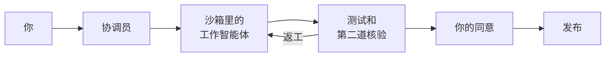

# Hansa Agents

[English](README.md)

**Hansa 是一支 AI 编程智能体团队，替你开发和维护软件产品，拿主意、点头放行的始终是你。你用平常的话说需求，协调员替你规划工作、把项目记录在案；来自几家模型厂商的智能体负责开发、测试并互相检查，没有你的同意，什么都不会发布。**

它跑在一台由你掌控、一直开着的机器上，比如家里的 Mac mini 或租来的 Linux 服务器；你在哪里都能用 SSH 连上它。它不是托管服务：工作台、密钥和登录信息都在那台机器上。

- **状态**：Alpha 版，`0.5.0a1`，设置、命令和文件都还可能变。0.4 及以前，这个项目叫 Bellhop。
- **运行环境**：macOS 或 Linux，需要 Python 3.9 以上、git 和 Claude Code；可以用 [`hansa doctor`](#快速开始) 检查这台机器是否满足。
- **使用方式**：`hansa` 菜单和命令，以及一个经 SSH 隧道（从你电脑到那台机器的私密连接）打开的网页。
- **许可证**：MIT

## 适合谁

**首先是管产品、但不写代码的人**：创业者、工作室老板、产品负责人。你只和一个智能体打交道，叫作**协调员**：不清楚的地方它会问你，也会提改进建议，再把你的想法拆成一件件任务。平时你能得到：

- 协调员替你管项目：每个目标都按你的原话记下，每个决定都记着理由和拍板的人，任务和你的待办都挂在各自的目标下；网页上每个目标做完了什么、还缺哪些证据、花了多少钱、用了几轮，一目了然；清空会话后，或者几周后开新会话，都能从这些记录接着干（[目标与产品决定（英文）](docs/tasks.md#goals-and-product-decisions)）；
- 一个网页，看得到正在做的事、等你处理的事，以及这些工作花了多少钱；
- 发到手机或团队群里的提醒（Bark、ntfy、Telegram、Slack、Discord、企业微信、钉钉、飞书等，见[推送服务](docs/zh-CN/push-services.md)）；
- 审批：发布要等你点头，或者用你事先批准的发布目标；
- 一台机器管几个产品：每个产品一个**工作台**（一个文件夹，放着团队的设置、任务和记录），一台机器可以同时跑好几个工作台，无人值守地连续运转几周。

**其次是开发者**：活多到一个智能体会话忙不过来的人。

**它不是：**

- 编辑器插件，也不是结对编程的聊天工具。你把活交给它，过后回来看结果。
- 托管服务、手机应用或远程控制工具。Hansa 跑在你自己的机器上，手机上收的是提醒和网页。
- 反复打磨界面设计的工具。设计请在别处做完，再把定稿当作任务的材料交给 Hansa。

## 快速开始

```sh
curl -fsSL https://raw.githubusercontent.com/FrostNovaOrg/Hansa/main/install.sh | sh
hansa doctor
hansa init ~/shop/desk --repo ~/shop/repo
hansa
```

如果提示找不到 `hansa`，按安装程序的提示，加上它打印的那行 `export PATH`。

也可以在那台机器上打开 Claude Code，让它按 [SETUP.md（英文）](SETUP.md) 一步一步问你，和你一起装好 Hansa。这份说明是写给智能体看的，它会用你的语言和你交流。

`~/shop/repo` 是你项目的 git 仓库，里面至少要有一次提交；`~/shop/desk` 是新建的工作台。后面的步骤见[上手指南](docs/zh-CN/getting-started.md)。

## 工作原理



**工作智能体**是一次只做一件任务的智能体，在一个隔离的空间（沙箱）里，用你代码的一份独立副本干活。这样一份副本连同它自己的规则就叫一条**工作线**：用哪些模型服务商、能访问哪些主机、跑哪些测试（叫作这条工作线的检查）、怎么发布。

1. **协调员把任务排进队列**（`hansa add`）。每件任务只做一处改动，工作智能体能独立完成并自己检查。
2. **一直运行的 `hansa serve` 把任务派给空闲的工作线。** 工作智能体在沙箱里改好，写一份报告。
3. **Hansa 提交并检查。** 测试由 Hansa 自己运行，结果不取决于工作智能体的报告。
4. **协调员审查。** 改了代码的，另派一个工作智能体实际试一遍，看改动是否站得住（`hansa verify`）；协调员据此合并或返工。
5. **由你发布。** Hansa 把改动合并进工作线的基础分支后就停下。只有你同意了，或者这个发布目标已事先批准，它才运行发布命令，比如部署。

给开发者：更详细的流程图见[工作怎么流转](docs/zh-CN/concepts.md#工作怎么流转)。

## 有意用多家模型

一条工作线可以用 Claude Code 的登录、任何兼容 Anthropic API 的接口（比如 DeepSeek 或 Kimi 的），在 macOS 上还可以通过 [`contrib/codex`（英文）](contrib/codex/README.md) 用 Codex 的命令行。可以让一家模型写改动、另一家来核验；某家服务商的用量到了上限，任务会转给下一家。所有服务商的费用在网页上汇总在一处，`hansa cost --by provider` 还能按服务商分开看。

## 它做过什么

Hansa 本身就是用 Hansa 开发的。下面的数字来自一个工作台截至 2026 年 11 月 2 日的 60 天，你的数字会不一样。

| 指标 | 数值 |
|---|---|
| 合并的改动 | 345 件 |
| 无需返工即可合并的改动 | 57% |
| 判为“未通过”的核验 | 37% |
| 每合并一件改动的成本（按官方标价） | US$8.65，协调员、工作智能体和核验的用量全部算在内 |

用订阅的话，实际账单就是订阅费；这里的金额是把用掉的 token 按官方标价折算出来的。

## 你的 Claude Code，你的登录

Hansa 运行的是你自己安装的 Claude Code，用你自己的账号或密钥登录。它不附带、不修改、也不转售 Claude Code。工作智能体的用量算在你自己的套餐里，适用你所用服务商的条款；用得多，会更早碰到套餐的上限。不要用你的订阅登录给别人提供工作台：Anthropic 的使用政策不允许借消费者套餐转发请求的服务。Hansa 是独立项目，与 Anthropic 和 OpenAI 都没有隶属关系，也没有得到它们的认可。

## 安全靠什么

- **工作智能体跑在操作系统的沙箱里。** 只能写工作线允许的位置，只能连工作线列出的主机，读不到工作台的密钥；你在工作线上允许的网页工具不受这份主机名单限制。[工作智能体与沙箱（英文）](docs/sandbox.md)
- **协调员不在沙箱里。** 尚未获准的命令，Claude Code 都会先问你；另有规则禁止它读取密钥、直接改代码。禁止推送的规则只拦得住写明的那些写法，其余写法靠 Claude Code 先问你。[谁改什么（英文）](docs/who-changes-what.md)
- **发布要等你**，或者用你事先批准的发布目标。发布在沙箱外运行，用的是工作台所在账号的登录信息。[发布与提醒（英文）](docs/releases.md)
- **密钥不外露。** 密钥放在 `secrets/` 里，Hansa 所用的账号读得到，只发给对应的服务商。Hansa 会在可能显示密钥的地方把它隐去，含密钥的改动一律不合并，但看不到压缩文件里面的内容。[工作台（英文）](docs/desk.md#where-a-desks-files-are)
- **网页默认不对外。** 它只监听本机，要用 `hansa web` 打印的地址里的令牌才能访问。`hansa serve --host` 可以开放给更大的范围，那时拿到这个地址的人就能批准发布。[令牌（英文）](docs/who-changes-what.md#a-claude-code-sessions-identity-and-the-pages-token)

更多见[限制](docs/zh-CN/concepts.md#限制)。

## 文档

用 Hansa 不需要读它的代码。[上手指南](docs/zh-CN/getting-started.md)、[概念](docs/zh-CN/concepts.md)、[工作台怎么运转](docs/zh-CN/principles.md)和[推送服务](docs/zh-CN/push-services.md)已有中文版，其余文档目前是英文。

### 从这里开始

| 文档 | 内容 |
|---|---|
| [上手指南](docs/zh-CN/getting-started.md) | 安装、登录、新建工作台、经 SSH 打开网页、完成第一件任务 |
| [SETUP.md（英文）](SETUP.md) | 写给智能体的安装说明，它会用你的语言陪你装好：对 Claude Code 说“读 SETUP.md，和我一起装好 Hansa” |
| [概念](docs/zh-CN/concepts.md) | 关键术语、工作怎么流转、工作台的文件、macOS 与 Linux、限制、命令、升级 |
| [工作台怎么运转](docs/zh-CN/principles.md) | Hansa 的运行规则、由什么来执行，以及各自防范的问题 |
| [推送服务](docs/zh-CN/push-services.md) | 把提醒发到手机和群聊：Bark、ntfy、Telegram、Slack、企业微信、钉钉、飞书等 |

### 参考

| 文档 | 内容 |
|---|---|
| [`hansa/card.md`（英文）](hansa/card.md) | 协调员的常设说明和全部命令；每个工作台里都有一份副本，名为 `CLAUDE.md` |
| [谁改什么（英文）](docs/who-changes-what.md) | 哪些由你在网页上设、哪些由协调员设，以及始终不对它开放的部分 |
| [工作智能体与沙箱（英文）](docs/sandbox.md) | 工作智能体和核验能碰什么、可写清单、允许的主机、被拒绝的路径 |
| [任务怎么运行（英文）](docs/tasks.md) | 时间上限、接着做、断线后重试、服务商的用量上限 |
| [发布与提醒（英文）](docs/releases.md) | 发布目标、一次性代码、中止发布、你的提醒命令 |
| [在 Linux 服务器上（英文）](docs/linux-server.md) | 协调员以 root 运行、工作台用普通账号、Linux 的沙箱 |
| [工作线里的 Java 和 Maven（英文）](docs/java-and-maven.md) | 沙箱里的 Maven 和 Java、对构建脚本的影响、对项目的要求 |
| [工作台：文件、密钥和笔记（英文）](docs/desk.md) | 密钥、协调员的规则和笔记、剩余空间、哪些文件会越来越大 |
| [CHANGELOG.md（英文）](CHANGELOG.md) | 每个版本改了什么，包括 Bellhop 时期的版本 |
| [CONTRIBUTING.md（英文）](CONTRIBUTING.md) | 怎么参与修改 Hansa，以及贡献内容的许可方式 |

`hansa help <topic>` 在终端里打印 `docs/` 中的一页，`hansa help card` 打印协调员的说明。

## 参与贡献与许可证

想修改 Hansa，请先读 [CONTRIBUTING.md（英文）](CONTRIBUTING.md)。

[MIT](LICENSE)。Copyright (c) 2026 FrostNovaOrg.
