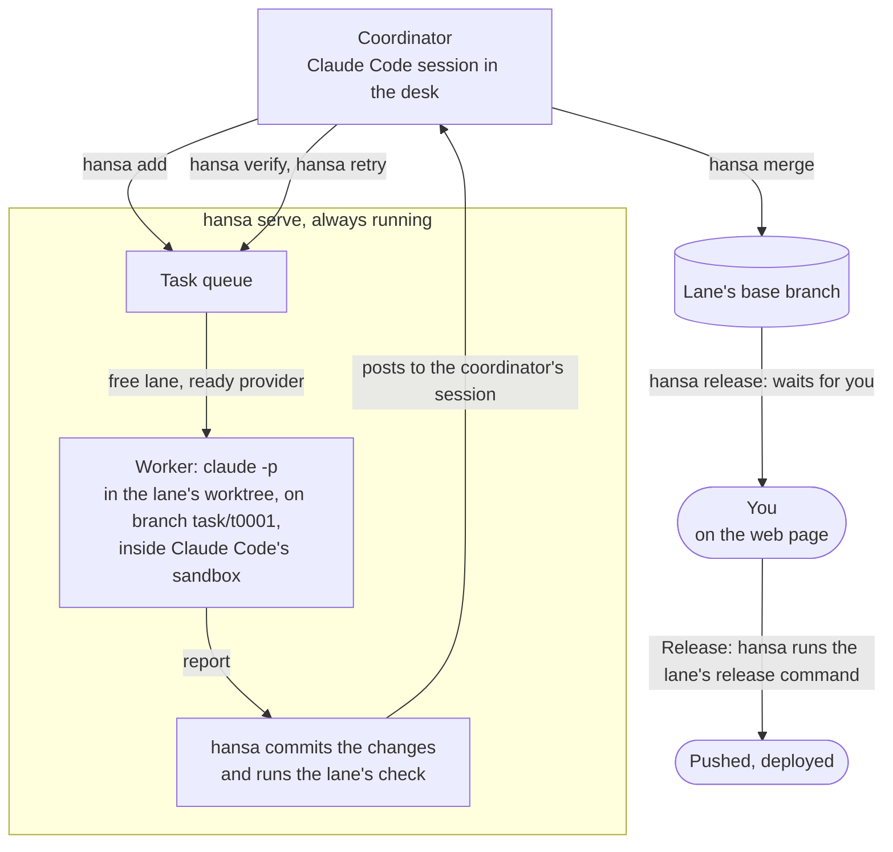

# Concepts

[简体中文](zh-CN/concepts.md)

The [README](../README.md) has the overview.

## Key terms

| Term | What it is |
|---|---|
| **Principal** | The person the desk works for. On the web page they set providers, keys, models and prices, read their to-dos and approve or refuse releases. They answer to-dos in the conversation, and the coordinator records each outcome. The principal can also answer a release request in the conversation with the one-time code in their alert. |
| **Coordinator** | An interactive Claude Code session in the desk (`hansa coordinator`). It plans, queues, reviews and merges work through `hansa`, and sets up the lanes. It runs outside the sandbox, so it can install what a lane needs; Claude Code asks the principal before each command not already allowed. Its interface is [`hansa/card.md`](../hansa/card.md), with `hansa help` covering the rest. |
| **Helpers** | Three subagents in the coordinator's session: `scout` (looks something up) and `reviewer` (reads a high-stakes change) only read; `operator` does one hands-on job on the machine, such as installing software. |
| **Worker** | One `claude -p` run per task, or per verification (`hansa verify`). It may run any command inside Claude Code's sandbox; its commands write only in its worktree and the folders its lane allows, and reach only its lane's hosts. It never commits. |
| **Desk** | One folder that holds a team's settings, keys, tasks and an append-only event log. The command line, the web page and the agents all read the same files. |
| **Lane** | A git checkout for workers: its base branch, a worktree of its own, its provider order, the hosts and folders its workers may reach, and its setup, check and release commands. A lane runs one task at a time; lanes on the same repository run tasks side by side, up to `hansa concurrency`. |
| **Provider** | Where a run gets its model: a Claude Code login (a subscription), or any endpoint that speaks the Anthropic API, with its key. A provider that hits its usage limit rests, and its task moves to the lane's next ready provider, or waits for one. |
| **Check** | A lane's test command. hansa runs it on each task's branch, in the lane's sandbox; a failed check blocks the merge unless the coordinator overrides it, which is recorded. |
| **Release** | Sending a lane's base branch out through one of its named release targets, after the principal's yes. It runs outside the sandbox, as the desk's account. |

## How work moves

This chart follows one task from the coordinator's `hansa add` to a release, with the commands at each step.



## The desk

A desk is one folder of plain files:

```text
desk/
├── settings.json          the principal's settings (set on the page) and the lanes (the coordinator's)
├── secrets/               provider keys; written by the page, never shown
├── CLAUDE.md              the card, a copy of hansa/card.md
├── .claude/               the coordinator's permission rules and helpers (your own rules: settings.local.json)
├── lanes/<lane>/brief.md  standing instructions sent to every worker in a lane
├── tasks/<id>/            each task's text, record and report, and what its processes wrote, keys removed
├── worktrees/<lane>/      one git worktree per lane
├── notes/                 the coordinator's notes; notes/PROJECT.md holds the project's own rules
├── events.jsonl           append-only record of everything that happened
├── asks.json              requests from the agents to the principal
├── PAUSED                 present: queued tasks and releases without asking wait
├── statusline.json        what hansa serve last counted, for the status line of the coordinator's session
└── .hansa/                runtime state: providers' rests, the heartbeat, the page's token and port, releases
```

Pausing stops queued tasks from starting, including follow-ups and verifications.
Running work finishes, including its checks. Lane tries (`hansa lane try`), merge
checks and releases the principal said yes to can still start. Releases set to go
out without asking and new Linux bench runs wait until `hansa resume`.

More: [The desk: files, keys and notes](desk.md).

## macOS and Linux

| | macOS | Linux |
|---|---|---|
| Workers' sandbox | Built in | Needs `bubblewrap` and `socat`; AppArmor on Ubuntu 24.04 and later can stop it |
| `localhost` on a lane's network list | Needed for workers' own local servers, but opens every service on the machine's loopback: list it only when nothing there must be kept from workers | Leave it off: each sandbox has a loopback of its own, and it would only open the machine's loopback through the sandbox's proxy |
| Builds in the sandbox | `mktemp` ignores `TMPDIR` unless given a template there, and is refused: [Java and Maven in a lane](java-and-maven.md) | The mount table can call a writable folder read-only, and git there leaves out the sandbox's placeholder files: [On a Linux server](linux-server.md#what-a-lanes-commands-meet-in-linuxs-sandbox) |
| As root | — | The coordinator may run as root, with the desk owned by an ordinary account: [On a Linux server](linux-server.md) |

## Limits

- Alpha: settings, commands and files may still change between versions.
- A worker's commands and the lane's setup and check run in the operating system's sandbox. The coordinator
  runs as the desk's user (or as root on a Linux server). Use a user account or machine for a desk only if that
  code may reach all of that account's or machine's files.
- With the [Codex adapter](../contrib/codex/README.md), a Codex run's commands can read the Codex login: Codex and
  the commands it runs share one sandbox, and every Codex run, on any lane, uses that one login. Claude workers
  cannot read it, and a Codex run's network reaches only the lane's hosts and OpenAI's.
- A release's command runs outside the sandbox, as the desk's account. Anything it builds and starts from the base
  branch also runs outside the sandbox as that account, so list a lane's build and release files as its `release_files`.
- The coordinator's rules against pushing and publishing catch only the forms they name. A command in another
  form waits for the principal only if Claude Code asks before running it.
- hansa replaces the principal's keys wherever it shows or records text, and will not merge a change that
  holds one. It cannot see into compressed files, and the event log keeps what it recorded before a key was
  saved.
- When a run ends, hansa stops what it left running. A process can still escape if it moves out of every marker
  and out of the worktree between two of `hansa serve`'s rounds and its parent ends before the next round: see
  [what hansa stops when a run ends](sandbox.md#what-hansa-stops-when-a-run-ends).
- A lane repository's merge hooks run while `hansa merge` holds the desk, so `hansa serve` waits for them.
- One `hansa serve` per desk, on one machine.

## Everyday commands

The coordinator runs these; you can too. Every coordinator command is in
[`hansa/card.md`](../hansa/card.md), which `hansa help card` prints. `hansa help`
lists commands and topics, and `hansa help <topic>` prints one from `docs/`. A
relative link in a topic prints as its words and where to read the section, so
it can be followed in a terminal: `hansa help TOPIC` when a topic prints that
section, else the file under `docs/` and its heading.
`hansa --help` lists every command, including the principal's `init`, `serve`,
`web`, `coordinator` and `ping`; `hansa <command> --help` or
`hansa help <command>` shows its options.

| Command | What it does |
|---|---|
| `hansa`, `hansa menu` | The principal's terminal menu: choose, start, stop and enter this account's desks |
| `hansa status` | Whether `hansa serve` runs, the page's address, the lanes, what is running, waiting or failed, the providers, the last 24 hours |
| `hansa add "<task>" [--lane L]` | Queue a task |
| `hansa show ID`, `hansa diff ID` | A task's report, its check, the files it changed, what to do next; its changes against the base |
| `hansa verify ID` | Have a worker run a finished task's change to see whether it holds; the verification itself is never merged |
| `hansa merge ID` | Merge a finished task into its lane's base branch |
| `hansa retry ID "<what to change>"` | Queue a follow-up on top of the earlier task (`--fresh`: from the base; `--update`: with the base merged in) |
| `hansa cancel ID`, `hansa close ID` | Stop queued, running or merging work; close finished work without merging |
| `hansa release L [TARGET] ["<note>"]` | Ask for a release of lane L's base branch; it runs after the principal's yes (a target ticked to go out without asking needs none) |
| `hansa release yes\|no ID CODE` | Pass on the principal's answer to a release, given in the conversation with their alert's one-time code |
| `hansa lane ...`, `hansa concurrency [N]` | List, add, change or remove lanes; how many tasks run at once |
| `hansa ask "<what>"`, `hansa ask [--closed]` | Record a to-do for the principal; close it with `--close N "<outcome>"`; alone, list the open to-dos in full (`--closed`: the closed ones with their outcomes) |
| `hansa cost [--by day\|seat\|lane\|task\|goal\|model\|provider]` | Tokens, and what they are worth at the principal's prices |
| `hansa explain [lane L \| provider P \| server \| notify]` | This desk's current settings and state, and where each comes from |
| `hansa explain history [lane L \| provider P] [--last N]` | Who changed each setting, when, and its old and new values |

## Settings history

`hansa explain history` lists settings changes newest first. Each change, one
command or one page save, is a line with its local time (in the form
`hansa status` uses) and who made it, and under it each setting it changed,
with its path and old → new: `hansa init` is one change with all its fields.
Page saves are attributed to the principal; coordinator changes name the
command, such as `hansa lane set`. `hansa explain history lane g` limits the
list to lane g, including its release targets and standing instructions.
`hansa explain history provider astra` limits it to that provider, including
key changes. `--last N` shows the newest N matching changes, each with all its
fields; without it, all are shown. Removed lanes and providers can still be
looked up; a name that is neither a lane nor in the history is refused with a
failing exit code, as `hansa explain lane` and `hansa explain provider` refuse
one that is not there. The page's `/api/history` keeps the Unix times and
counts records.

`hansa explain lane L` and `hansa explain provider P` say, from this history,
which command made the lane or set the provider (`hansa init`, `hansa lane add`,
the principal on the web page) and which last changed it, naming the field or
target: `hansa lane target a preview`, `hansa lane set a check`,
`hansa lane brief a`.

Each changed setting gets one entry: `lanes.g.env`,
`providers.astra.model`, or `lanes.g.targets.preview.command`, for example.
Lists and a lane's environment dictionary are kept as whole values, so
clearing an environment shows its old variables → `{}`. Added or removed
settings show `(unset)` on the absent side. A lane's standing instructions
use `lanes.g.brief`. For entries the coordinator adds to the principal's list
of what workers may not read, hansa records who added them and when; those
details do not count as a second setting change. Saves that change nothing,
refused saves, and dry validation add no history.

All settings writers record changes: the page, `hansa init`, `hansa example`,
`hansa lane add/set/remove/target/brief`, `hansa hide`, `hansa concurrency`,
`hansa disk-floor`, and `hansa memory-floor`. This records changes made through
hansa; edits made directly to files are not observed.

Provider keys and tokens show only `set (values withheld)` when saved or
`cleared (values withheld)` when removed; older records still show
`changed (values withheld)`, with neither
value stored. If either value contains a key hansa knows, both are withheld.
This check happens before shortening a value, including within lists and
dictionaries. Other values are kept up to 2,048 characters of their JSON
spelling; longer values explicitly say `truncated`. Listing also withholds
values containing a key hansa knows now.

History is appended under the desk lock to `.hansa/settings-history.jsonl`,
separate from `events.jsonl`, so simultaneous changes both land and listing
history never reads the activity log. The file survives server restarts;
keep it when copying or restoring a desk. Its first line records when this
history began: desk creation, or the first recorded change or history lookup
after upgrading an older desk. The command always shows that time, including
when there are no entries yet. Earlier changes cannot be reconstructed from
the old events.

## Upgrading and going back

**Upgrading.** In the desk, run `hansa pause "upgrade"` to keep queued tasks from starting
while running work finishes. Lane tries, merge checks and releases the principal said yes
to can still start. `hansa status` lists what runs; wait until nothing runs.

In hansa's clone (`~/.local/share/hansa` with the installer), record `git rev-parse HEAD`
so you can go back. To pin a version, run `git fetch origin`, then
`git checkout --detach COMMIT` with the commit you want. The installation stays
at that commit. To upgrade a pinned installation, fetch again and check out
the next commit the same way.

The installer updates an existing clone with `git pull --ff-only`; this cannot update a
detached checkout. To return to branch updates, run `git checkout main` in the clone
(or the branch you tracked before pinning). Check its upstream with `git branch -vv`,
then run the [installer](getting-started.md#install-hansa) again. The branch
must track its upstream, and the update must be a fast-forward.

Restart `hansa serve` to run the new code. If `hansa up` started the server, stop it with
`kill PID`, using the pid it printed, then run `hansa up` in the desk. It leaves running
servers alone. If you started it by hand, press Ctrl-C and rerun its `hansa serve` command
with the same options.

Server startup updates the card. The coordinator reads it when a session starts, after `/clear`
or after compaction; restart the session after changing its permissions, helpers, mod or launch
options. See [Starting the server and the coordinator again](desk.md#starting-the-server-and-the-coordinator-again).
Then run `hansa resume`. The first line of `hansa status` shows the version and when it was installed.

**Going back.** Follow the same steps with the commit you ran before. Newer commands may
write settings older code does not know: `hansa status` and `hansa add` can still work, but
saving settings is refused with `unknown setting: NAME` for each unfamiliar setting.
Undo settings made by newer commands before going back.

**What changed:** in the clone, run `git log --oneline OLD..NEW`.
