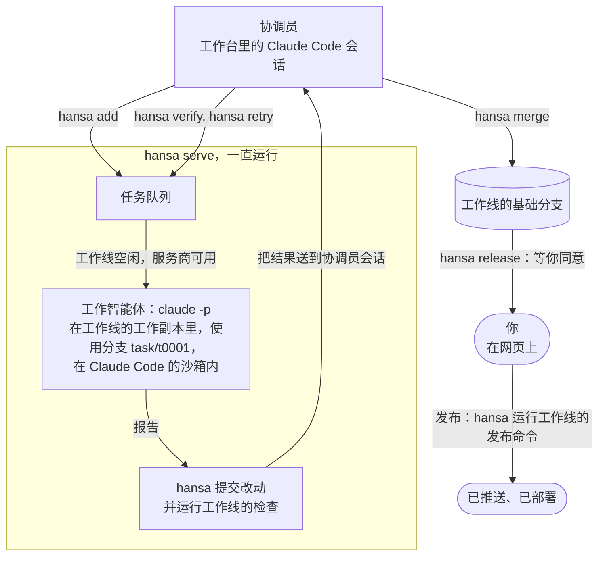

# 概念

[English](../concepts.md)

整体介绍见 [README](../../README.zh-CN.md)。

## 关键术语

| 术语 | 含义 |
|---|---|
| **负责人** | 工作台为之工作的人，也就是你。你在网页上设置服务商、密钥、模型和价格，查看待办，批准或拒绝发布。待办在对话里答复，协调员会记下每件事的结果。发布请求也可以在对话里答复，需要用提醒中的一次性代码确认。 |
| **协调员** | 工作台里的一个交互式 Claude Code 会话（`hansa coordinator`）。它通过 `hansa` 规划工作、安排任务、审查和合并改动，也负责设置工作线。它在沙箱外运行，可以安装工作线需要的软件；尚未获准的命令，Claude Code 都会先问负责人。它按 [`hansa/card.md`（英文）](../../hansa/card.md)操作，其余说明由 `hansa help` 提供。 |
| **助手** | 协调员会话里的三个子智能体：`scout`（调研助手，查资料）和 `reviewer`（复核助手，审查影响重大的改动）只读取内容；`operator`（操作助手）负责在机器上实际做一件事，比如安装软件。 |
| **工作智能体** | 每件任务或每次核验（`hansa verify`）各运行一次 `claude -p`。它可以在 Claude Code 的沙箱里运行任何命令；命令只能写入自己的工作副本和工作线允许的文件夹，只能连接工作线允许的主机。它从不提交改动。 |
| **工作台** | 一个文件夹，存放团队的设置、密钥、任务和只能追加、不能改写的事件记录。命令行、网页和智能体读的都是这些文件。 |
| **工作线** | 给工作智能体用的一份 git 工作副本，连同它的基础分支、服务商使用顺序、允许访问的主机和文件夹，以及准备、检查和发布命令。一条工作线一次只做一件任务；同一仓库的多条工作线可以同时做任务，同时运行的数量由 `hansa concurrency` 限定。 |
| **服务商** | 一次运行所用模型的来源：可以是 Claude Code 的订阅登录，也可以是兼容 Anthropic API 的接口及其密钥。某家服务商的用量到了上限，就会暂时休息，任务转给工作线上下一家可用的服务商；没有可用的就等待。 |
| **检查** | 工作线的测试命令。hansa 会在工作线的沙箱里，对每件任务的分支运行这条命令。检查未通过就不允许合并，除非协调员明确决定仍要合并，这个决定会记入记录。 |
| **发布** | 负责人同意后，通过工作线的某个具名发布目标，把基础分支的内容发布出去。发布在沙箱外运行，使用工作台所在的系统账号。 |

## 工作怎么流转

下图展示一件任务从协调员运行 `hansa add` 到发布的过程，以及每一步所用的命令。



## 工作台

一个工作台就是一个文件夹，里面都是普通文件：

```text
desk/
├── settings.json          the principal's settings (set on the page) and the lanes (the coordinator's)
├── secrets/               provider keys; written by the page, never shown
├── CLAUDE.md              the card, a copy of hansa/card.md
├── .claude/               the coordinator's permission rules and helpers (your own rules: settings.local.json)
├── lanes/<lane>/brief.md  standing instructions sent to every worker in a lane
├── tasks/<id>/            each task's text, record and report, and what its processes wrote, keys removed
├── worktrees/<lane>/      one git worktree per lane
├── notes/                 the coordinator's notes; notes/PROJECT.md holds the project's own rules
├── events.jsonl           append-only record of everything that happened
├── asks.json              requests from the agents to the principal
├── PAUSED                 present: queued tasks and releases without asking wait
├── statusline.json        what hansa serve last counted, for the status line of the coordinator's session
└── .hansa/                runtime state: providers' rests, the heartbeat, the page's token and port, releases
```

暂停后，排队中的任务不会启动，包括后续任务和核验。已经运行的工作会继续完成，连同它的检查。工作线试运行（`hansa lane try`）、合并检查，以及负责人已明确同意的发布仍可启动。设为免询问的发布和新的 Linux 测试台运行要等到 `hansa resume` 后才能启动。

更多见[工作台：文件、密钥和笔记（英文）](../desk.md)。

## macOS 与 Linux

| | macOS | Linux |
|---|---|---|
| 工作智能体的沙箱 | 系统自带支持 | 需要 `bubblewrap` 和 `socat`；Ubuntu 24.04 及更新版本的 AppArmor 可能拦住它 |
| 工作线网络名单里的 `localhost` | 工作智能体要运行自己的本地服务时需要它，但加入后，这台机器回环地址上的所有服务都会开放给工作智能体；只有这些服务都无需对工作智能体保密时才加入 | 不要加入：每个沙箱都有自己的回环地址，加入它只会通过沙箱的代理开放这台机器的回环地址 |
| 在沙箱里构建 | `mktemp` 除非明确使用 `TMPDIR` 里的路径模板，否则会忽略它，因而被拒绝；见[工作线里的 Java 和 Maven（英文）](../java-and-maven.md) | 挂载表可能把可写文件夹显示成只读，git 也会忽略沙箱的占位文件；见[在 Linux 服务器上（英文）](../linux-server.md#what-a-lanes-commands-meet-in-linuxs-sandbox) |
| 以 root 运行 | — | 协调员可以用 root 账号运行，工作台归普通账号所有；见[在 Linux 服务器上（英文）](../linux-server.md) |

## 限制

- 目前是 Alpha 版：设置、命令和文件仍可能随版本变化。
- 工作智能体的命令，以及工作线的准备步骤和检查，都在操作系统的沙箱里运行。协调员使用工作台所在的系统账号运行（在 Linux 服务器上也可以用 root）。只有你允许这些代码访问该账号或该机器上的全部文件时，才用这个账号或这台机器运行工作台。
- 使用 [Codex 适配器（英文）](../../contrib/codex/README.md)时，Codex 运行的命令能读取 Codex 的登录信息：Codex 和它运行的命令共用一个沙箱，而且所有工作线上的 Codex 运行都共用这一个登录。Claude 工作智能体读不到它；Codex 运行时只能连接工作线允许的主机和 OpenAI 的主机。
- 发布命令在沙箱外运行，使用工作台所在的系统账号。从基础分支构建和启动的程序也会在沙箱外以该账号运行，因此要把工作线的构建和发布文件列入 `release_files`。
- 禁止协调员推送和发布的规则只拦得住写明的那些命令写法。其他写法只有在 Claude Code 运行前询问负责人时，才会停下来等你同意。
- hansa 在显示或记录文本时会隐去负责人的密钥，也不会合并含有密钥的改动。但它看不到压缩文件里的内容；在密钥保存之前已经写入事件记录的内容也会保留。
- 一次运行结束时，hansa 会停止它留下的进程。不过，如果某个进程在 `hansa serve` 的两轮巡查之间脱离了所有追踪标记、离开工作副本，而且它的父进程在下一轮巡查前结束，它仍可能逃过清理。见[一次运行结束时 hansa 会停止什么（英文）](../sandbox.md#what-hansa-stops-when-a-run-ends)。
- `hansa merge` 运行工作线仓库的合并钩子（合并时自动运行的脚本）时，会一直持有工作台锁，因此 `hansa serve` 需要等这些脚本结束。
- 一个工作台只能在一台机器上运行一个 `hansa serve`。

## 日常命令

这些命令由协调员运行，你也可以自己用。协调员的全部命令都在 [`hansa/card.md`（英文）](../../hansa/card.md)里，运行 `hansa help card` 可以打印这份说明。`hansa help` 列出命令和帮助主题，`hansa help <topic>` 打印 `docs/` 里对应的一篇文档。文档里的相对链接会打印成链接文字和查找该小节的位置，方便在终端里照着查找：如果该小节是帮助主题，就打印 `hansa help TOPIC`；否则打印 `docs/` 下的文件和标题。`hansa --help` 列出所有命令，包括负责人使用的 `init`、`serve`、`web`、`coordinator` 和 `ping`；`hansa <command> --help` 或 `hansa help <command>` 显示该命令的选项。

| 命令 | 用途 |
|---|---|
| `hansa`, `hansa menu` | 负责人的终端菜单：选择、启动、停止和进入这个账号下的工作台 |
| `hansa status` | 查看 `hansa serve` 是否运行、网页地址、工作线、正在运行、等待或失败的任务、服务商，以及过去 24 小时的情况 |
| `hansa add "<task>" [--lane L]` | 把任务排进队列 |
| `hansa show ID`, `hansa diff ID` | 查看任务报告、检查结果、改了哪些文件、下一步该做什么；查看相对基础分支的改动 |
| `hansa verify ID` | 让另一个工作智能体实际试用已完成任务的改动，看是否站得住；核验本身的改动不会合并 |
| `hansa merge ID` | 把已完成的任务合并进工作线的基础分支 |
| `hansa retry ID "<what to change>"` | 在原任务的改动上安排后续任务（`--fresh`：从基础分支重新开始；`--update`：先合入基础分支的更新） |
| `hansa cancel ID`, `hansa close ID` | 停止排队、运行或合并中的任务；关闭已完成或失败的任务或核验，不合并 |
| `hansa release L [TARGET] ["<note>"]` | 请求发布工作线 L 的基础分支，负责人同意后才会运行（负责人已勾选为免询问的发布目标无需再次同意） |
| `hansa release yes\|no ID CODE` | 转达负责人在对话中给出的发布答复，用提醒里的一次性代码确认 |
| `hansa lane ...`, `hansa concurrency [N]` | 列出、添加、修改或移除工作线；设置同时运行的任务数量 |
| `hansa ask "<what>"` | 给负责人记一件待办；用 `--close N "<outcome>"` 记录结果并关闭 |
| `hansa cost [--by day\|seat\|lane\|task\|goal\|model\|provider]` | 查看 token 用量，以及按负责人所设价格折算的金额 |
| `hansa explain [lane L \| provider P \| server \| notify]` | 查看工作台当前的设置和状态，以及各项的来源 |
| `hansa explain history [lane L \| provider P] [--last N]` | 查看谁在何时改了哪项设置，以及改前和改后的值 |

## 设置历史

`hansa explain history` 按从新到旧的顺序列出设置变更：每次变更（一条命令或一次网页保存）占一行，写明本地时间（格式与 `hansa status` 相同）和谁改的，其下逐项列出它改的设置路径，以及旧值 → 新值；`hansa init` 算一次变更。在网页上保存的设置记为负责人所改；协调员的改动则注明所用命令，比如 `hansa lane set`。`hansa explain history lane g` 只列出工作线 g 的变更，包括发布目标和常设说明。`hansa explain history provider astra` 只列出该服务商的变更，包括密钥变更。`--last N` 只显示最新的 N 次匹配变更，每次带上它改的全部设置；不加则全部显示。已经移除的工作线和服务商也能查询；既不是现有工作线（或服务商）、历史里也没有的名字会被拒绝，退出码为失败，与 `hansa explain lane`、`hansa explain provider` 对不存在名字的处理相同。网页的 `/api/history` 仍给出 Unix 时间，并按记录计数。

`hansa explain lane L` 和 `hansa explain provider P` 根据这份历史说明工作线由哪条命令建立、服务商由谁设置（`hansa init`、`hansa lane add`、网页上的负责人），以及最近一次由哪条命令修改，并写明字段或目标：`hansa lane target a preview`、`hansa lane set a check`、`hansa lane brief a`。

每项被修改的设置各记一条，比如 `lanes.g.env`、`providers.astra.model` 或 `lanes.g.targets.preview.command`。列表和工作线的环境变量字典（变量名及其值）都作为一个整体保存，所以清空环境变量时，会显示原来的变量 → `{}`。新增或移除设置时，没有值的一侧显示 `(unset)`。工作线的常设说明使用路径 `lanes.g.brief`。对于协调员加入负责人禁读清单（列出工作智能体不得读取的路径）的条目，hansa 还记录是谁在何时加入的；这些记录不算另一项设置变更。没有实际改动的保存、被拒绝的保存，以及只校验而不保存的操作，都不会写入历史。

所有通过 hansa 保存设置的方式都会记录变更：网页、`hansa init`、`hansa example`、`hansa lane add/set/remove/target/brief`、`hansa hide`、`hansa concurrency`、`hansa disk-floor` 和 `hansa memory-floor`。这里只记录通过 hansa 做的改动，直接编辑文件的改动不会被记录。

服务商的密钥和令牌在新记录中，保存时只显示 `set (values withheld)`（已设置，值已隐藏），移除时只显示 `cleared (values withheld)`（已清除，值已隐藏）；旧记录仍显示 `changed (values withheld)`（已更改，值已隐藏），旧值和新值都不保存。`alert.command`（或整个 `alert` 设置）的变更也只显示 `changed (values withheld)`（已更改，值已隐藏），不保存旧值或新值，查询时对旧记录也适用这条规则。如果旧值或新值中有一方含有 hansa 已知的密钥，两方都会隐藏。这个检查在截短内容之前进行，也会检查列表和字典里的内容。其他值按 JSON 文本保存，最多保留 2,048 个字符；更长的值会明确标注 `truncated`（已截短）。查询历史时，含有 hansa 当前已知密钥的值也会隐藏。

历史记录在持有工作台锁时追加到 `.hansa/settings-history.jsonl`，与 `events.jsonl` 分开保存，保证同时发生的变更都能记下，也让查询历史无需读取活动记录。服务重启后，这个文件仍会保留；复制或恢复工作台时也要保留它。第一行记录这份历史从何时开始：新工作台是创建时间；旧工作台升级后，则是第一次记录变更或查询历史的时间。命令总会显示这个时间，即使还没有变更记录。更早的设置变更无法从旧事件中还原。

## 升级与退回旧版

**升级。** 在工作台里运行 `hansa pause "upgrade"`，暂停启动排队中的任务，让正在运行的工作做完。工作线试运行、合并检查，以及负责人已明确同意的发布仍可启动。用 `hansa status` 查看正在运行的工作，等到全部结束。

进入 hansa 的克隆仓库（用安装脚本安装时位于 `~/.local/share/hansa`），记下 `git rev-parse HEAD` 的输出，以便退回旧版。要固定版本，先运行 `git fetch origin`，再用 `git checkout --detach COMMIT` 切换到你选定的提交。安装的版本会停留在这个提交。固定版本后要升级，就再次获取更新，再用同样的命令切换到新的提交。

安装脚本用 `git pull --ff-only` 更新已有的克隆仓库，这条命令无法在分离 HEAD 状态下更新。要恢复随分支更新，先在克隆仓库里运行 `git checkout main`（或切回固定版本之前跟踪的分支）。用 `git branch -vv` 检查它的上游分支，再次运行[安装脚本](getting-started.md#安装-hansa)。该分支必须跟踪上游，而且这次更新必须能快进完成。

重启 `hansa serve`，让新代码生效。如果服务是由 `hansa up` 启动的，用它打印的进程号运行 `kill PID` 来停止服务，再在工作台里运行 `hansa up`。`hansa up` 不会重启已经运行的服务。如果服务是手动启动的，按 Ctrl-C 停止，再用相同选项重新运行原来的 `hansa serve` 命令。

服务启动时会更新协调员的常设说明。协调员在会话开始、执行 `/clear` 后，或对话压缩后读取这份说明；如果改了权限、助手、插件（mod）或启动选项，要重启协调员会话。见[重新启动服务和协调员（英文）](../desk.md#starting-the-server-and-the-coordinator-again)。然后运行 `hansa resume` 恢复工作。`hansa status` 的第一行会显示版本和安装时间。

**退回旧版。** 按相同步骤，切换到之前用的提交。新命令可能写入旧代码不认识的设置：`hansa status` 和 `hansa add` 仍可能正常工作，但保存设置会被拒绝，每个不认识的设置都会提示 `unknown setting: NAME`。退回旧版之前，先撤销新命令写入的设置。

**查看改了什么：** 在克隆仓库里运行 `git log --oneline OLD..NEW`。
